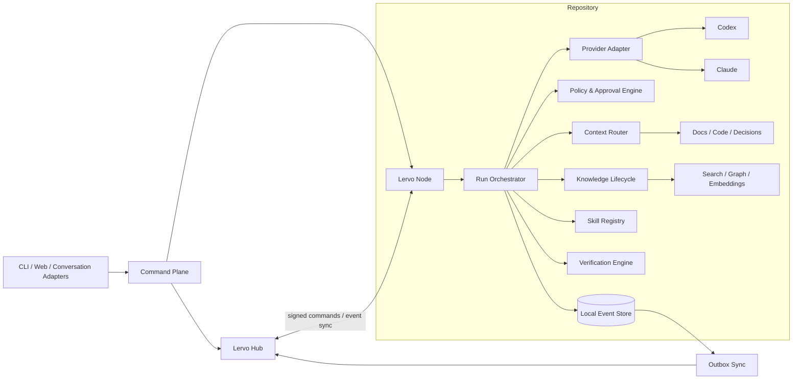
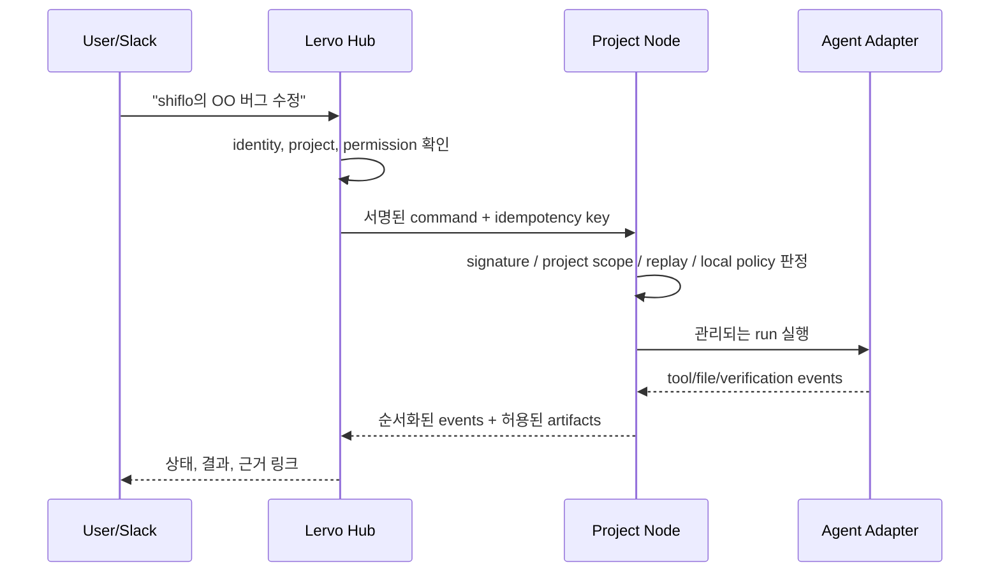

# Lervo 시스템 아키텍처

상태: `0.1-draft`  
기준일: 2026-08-20

## 전체 구조



## 배포 단위

### Lervo CLI

사람과 자동화의 로컬 진입점입니다. 초기화, 실행, 추적, 진단, 문서 점검, Hub 연결을 제공합니다.

명령 상태:

- `lervo init`: 저장소 탐지 및 안전한 초기 설정. project identity 첫 슬라이스 구현 완료
- `lervo run --provider <provider> --path <path> --verification <suite-id> [--verification <suite-id> ...] [--skill <skill-id> ...] <request>`: project storage, 스킬 해석, 프로젝트 검증과 managed provider coordinator를 연결하는 한 파일 실행 구현 완료
- `lervo trace [run]`: 실행 근거와 이벤트 조회
- `lervo doctor`: 문서·스킬·어댑터 로컬 상태 진단. Hub 연결 상태는 실제 transport와 연결 설정 구현 뒤 추가
- `lervo docs check`: 문서 노후화 검사
- `lervo hub connect`: 선택적 중앙 등록

### Lervo Node

저장소별 로컬 런타임입니다. 초기에는 CLI 프로세스 안에서 동작하고, 원격 작업과 장기 실행이 필요해질 때 선택적 데몬 모드를 제공합니다. Node가 원본 실행 이벤트를 소유합니다.

### Lervo Hub

다중 프로젝트의 제어·조회 계층입니다. 프로젝트 등록, 정책 배포, 추적 시각화, 원격 명령, 채널 연동을 담당합니다. 저장소 파일 시스템을 직접 마운트하지 않고 Node가 내보낸 이벤트와 허용된 아티팩트만 저장합니다.

M6 sync 계약은 전체 project manifest와 안정적인 project identity를 분리해 등록하고, allowlist event만 연속 batch로 전달합니다. Hub는 역순 batch를 보관할 수 있지만 project hash chain의 빈 구간이 채워진 가장 높은 seq까지만 cursor를 공개합니다. `@lervo/sync-contract`는 저장과 network가 없는 순수 수락 계획만 계산합니다.

`@lervo/sync`는 Node의 application 경계입니다. 매 cycle 등록을 확인한 뒤 현재 worker가 가진 destination별 outbox lease만 가져오고, hash chain이 이어지는 구간별 batch를 인증된 Hub transport port에 전달합니다. Peer 좌표와 durable ack 전체가 맞으면 해당 구간을 한 local transaction에서 ack하고, 응답 유실이나 검증 실패는 아직 ack하지 않은 lease만 공통 시각으로 재예약합니다. Transport 구현은 TLS·서명 등 실제 인증을 소유하며 core worker는 protocol을 알지 않습니다.

Hub 수신은 `@lervo/hub-sync`의 비동기 command handler와 `@lervo/hub-sync-sqlite`의 durable adapter로 나뉩니다. Handler는 commit 뒤 resolve하는 `registerProject`·`acceptEventBatch`만 알고 transaction callback이나 전체 project state를 노출하지 않습니다. SQLite는 최대 100개 batch의 중복 좌표와 인접 hash만 읽어 새 event와 cursor를 한 commit에 저장합니다. Store 시작은 bounded 구조 검사만 하고 전체 chain 검증은 명시적 audit로 분리합니다. 이 경계는 HTTP route나 Node 인증을 구현하지 않으며 인증·권한을 마친 transport만 handler를 호출해야 합니다.

`@lervo/hub-trace`는 저장 구현과 분리된 bounded query port에서 project summary와 run timeline을 읽습니다. Project, run과 event는 기본 50·최대 100개의 안정적인 cursor page이며 source adapter가 각 결과를 한 read transaction에서 만듭니다. Project/run count와 session 좌표는 event 원본과 같은 commit에서 갱신하는 재생성 가능한 read index라서 목록 조회가 전체 event 이력을 다시 훑지 않습니다. Project 목록은 ID·hash·cursor·집계 count만 가지며 event payload를 포함하지 않습니다. Run 상세는 허용된 page의 allowlist event를 seq 순서로 보여주되 cursor 이하 `continuous`와 gap 뒤 `buffered`를 분리합니다. Projection은 원본을 쓰거나 별도 index를 원본이라고 주장하지 않습니다. 결정은 [ADR-0038](./docs/adr/0038-bounded-async-hub-storage-and-trace.md)에 기록합니다.

`@lervo/hub` HTTP adapter는 구성된 bearer credential을 principal과 최대 256개의 project 좌표에 결속합니다. 인증된 요청마다 project-scoped reader를 만들고 목록 scope를 SQLite query까지 전달하며, scope 밖 상세는 source 호출 전에 거부합니다. 세 GET route는 종류가 구분되는 외부 cursor와 기존 100개 page 상한만 사용합니다. 모든 응답은 no-store이고 기본 1 MiB byte 한도를 가지며 credential·내부 예외를 고정 오류 본문에 넣지 않습니다. 결정은 [ADR-0039](./docs/adr/0039-authenticated-project-scoped-trace-http.md)에 기록합니다.

`/trace` web view는 데이터 없는 공개 shell과 고정 same-origin asset만 직접 제공합니다. 사용자가 입력한 token은 현재 탭 메모리에서 인증된 API 요청에만 쓰고 URL·storage·cookie에 두지 않습니다. Project, run과 event는 독립된 20개 page 영역이며 다음 page가 이전 DOM에 누적되지 않습니다. Project나 run 선택이 바뀌면 하위 영역을 비우고 늦게 끝난 이전 요청은 현재 pager와 다르면 반영하지 않습니다. Event의 continuous와 buffered는 각각 `연속 이력`, `연결 대기`로 표시합니다. 결정은 [ADR-0040](./docs/adr/0040-bounded-trace-web-view.md)에 기록합니다.

원격 실행은 `@lervo/remote-command-contract`의 공급자·transport 중립 command와 `@lervo/remote-command`의 Node 수신 경계로 나뉩니다. Command에는 project ID와 project identity hash, 역할·공급자·위험·필수 verification suite, 짧은 발급·만료 시각, nonce와 idempotency key가 들어갑니다. 요청 본문은 넣지 않고 최대 64 KiB의 UTF-8 artifact ID·content hash·byte 수만 서명합니다. Canonical command와 key ID를 domain-separated Ed25519 message로 서명하므로 다른 key나 protocol 용도의 서명을 재사용할 수 없습니다.

Node는 envelope schema와 파생 command ID, trust store의 key, 서명, signer project scope, receiver project identity를 먼저 확인합니다. 완료된 동일 command의 receipt 복구를 제외하면 freshness, 로컬 정책을 검사한 뒤 replay reservation을 원자적으로 만들고, 그 뒤에만 artifact를 읽어 hash·크기·UTF-8을 확인하고 공급자 중립 executor를 호출합니다. 정책 거부는 예약하지 않으므로 승인 뒤 같은 command를 다시 받을 수 있습니다. Payload 또는 실행 실패는 원문 없는 terminal receipt로 저장하며 같은 command를 다시 실행하지 않습니다. 결정은 [ADR-0041](./docs/adr/0041-signed-scoped-remote-command.md)에 기록합니다.

Hub의 원격 command queue는 event inbox와 같은 SQLite database 안의 별도 table과 repository를 사용합니다. 등록된 destination·project identity가 같은 command만 `pending`으로 저장하고, Node pull 시 짧은 `leased` 상태로 원자 전이합니다. 발급 전 command는 기다리고 만료 command는 executor에 보내지 않은 채 `expired`가 됩니다. Node의 terminal acknowledgement를 commit한 뒤에만 `completed` 또는 `rejected`로 바꾸며 command identity와 terminal 원본은 수정·삭제 trigger로 보호합니다. Queue 조회는 command/envelope 원문 대신 좌표·상태·시각·시도 횟수만 반환합니다.

Node reconnect worker는 인증된 transport port에서 한 번에 기본 1개, 최대 16개의 lease를 받습니다. Hub peer와 destination, node ID, project target, lease 시각을 다시 확인한 뒤 기존 receiver를 호출합니다. Node의 `@lervo/remote-command-sqlite`는 project ID·identity hash에 고정된 별도 database에 command hash, idempotency key, nonce, reservation과 receipt만 저장합니다. Hub acknowledgement 전 연결이 끊기면 lease 만료 뒤 같은 command를 다시 받아 이 receipt를 `duplicate`로 복구하므로 executor는 다시 열리지 않습니다. 실행과 receipt 저장 사이의 crash로 durable reservation만 남은 경우에는 실행 여부를 추정하지 않고 `in_progress`로 fail-closed합니다. 실제 HTTP/TLS command endpoint는 transport port 뒤의 후속 구현입니다. 결정은 [ADR-0042](./docs/adr/0042-durable-remote-command-delivery.md)에 기록합니다.

정책 배포 1차 슬라이스는 `@lervo/policy-contract`, `@lervo/policy`, `@lervo/policy-sqlite`로 나뉩니다. Hub transport가 반환하는 snapshot·승인·철회 bundle은 body를 읽기 전에 인증된 destination·peer를 확인하고, 각 원본의 project scope, purpose별 Ed25519 signature와 bounded 개수를 검증한 뒤 한 SQLite transaction으로 적용합니다. Snapshot은 sequence와 이전 snapshot ID로 기존 Node 이력에 연속되어야 하며 승인과 철회는 append-only 원본입니다. 첫 연결은 현재 서명 snapshot을 bootstrap할 수 있지만 이후 과거 sequence나 끊긴 다음 snapshot은 거부합니다.

원격 command 정책 평가기는 Role 기반 로컬 capability 결정과 현재 Hub rule 중 더 제한적인 값을 사용합니다. Hub `allow`는 로컬 `deny`나 `require_approval`을 완화하지 못합니다. 승인은 현재 snapshot ID/hash, command ID/hash, command signer key ID, capability와 저장소 상대 경로에 묶이고 발급 전·만료 후·철회 시각 이후에는 사용할 수 없습니다. 승인 대기는 replay reservation과 terminal Hub rejection을 만들지 않으므로 lease가 다시 전달될 때 같은 signed command를 재평가합니다. 평가 시 SQLite에 저장된 snapshot·승인·철회의 signature도 다시 검증합니다.

승인된 remote command는 재검증용 command·signer·snapshot·approval 좌표를 managed provider coordinator에 전달합니다. Coordinator는 provider 시작 전 전체 run과 예상 경로를, 실제 쓰기 직전에는 현재 요청 경로와 시각을 포함해 같은 signed 원본을 다시 확인합니다. `require_approval`은 이 두 검사와 E3·before hash가 모두 통과할 때만 approval ID와 snapshot ID가 묶인 기존 1회용 permit를 엽니다. 결정은 [ADR-0043](./docs/adr/0043-signed-policy-and-command-bound-approval.md)과 [ADR-0044](./docs/adr/0044-signed-approval-managed-write-permit.md)에 기록합니다.

Hub 정책 작성은 `@lervo/hub-policy` application 경계와 `HubPolicySourceStore` port로 분리합니다. 작성기는 현재 Hub snapshot head와 durable remote command 원본을 읽어 새 snapshot·승인·철회를 만들고 configured signer로 목적별 서명합니다. HTTP client가 발급·승인·철회 시각을 정하지 않으며 Hub가 한 시각을 원본 시각과 발행 시각으로 사용합니다. 승인자 principal은 project identity와 함께 SHA-256으로 바꾼 subject hash만 원본에 들어갑니다.

`@lervo/hub-sync-sqlite`의 정책 repository는 event inbox·command queue와 같은 Hub database에서 project registration과 command foreign key를 공유하지만, 정책 codec·reader·writer는 기존 저장 관심사와 분리합니다. Snapshot, approval과 revocation은 별도 append-only table에 보존하고 update/delete trigger로 막습니다. 새 snapshot은 현재 head 바로 다음만 허용합니다. 처음 연결한 Node에는 최신 snapshot, 뒤처진 알려진 cursor에는 다음 snapshot 하나, head cursor에는 늦게 추가된 같은 snapshot의 승인·철회를 반환합니다. 알 수 없는 cursor는 충돌이며 한 snapshot당 승인·철회는 각각 64개입니다. 명시적 전체 audit는 모든 snapshot chain과 과거 승인-command 관계까지 다시 검사합니다.

`@lervo/hub`는 bearer principal의 `policy.read`·`policy.write`와 destination/project scope를 source 호출 전에 확인합니다. 정책 write body는 기본 256 KiB, 모든 응답은 기본 1 MiB·`no-store`이며 고정 오류만 반환합니다. Node의 `AuthenticatedPolicyHttpTransport`는 credential이 없는 HTTPS URL을 기본으로 강제하고 bearer token, 요청 좌표와 `x-lervo-hub-identity`를 확인한 뒤 bounded JSON만 policy sync port로 넘깁니다. 요청은 기본 15초 뒤 중단하며 평문 HTTP는 로컬 fixture에서 명시적으로만 허용합니다. 자세한 결정은 [ADR-0045](./docs/adr/0045-hub-policy-authoring-and-http-sync.md)에 기록합니다.

## 저장소 내부 구조

`lervo init`의 목표 구조입니다.

```text
.lervo/
  project.yaml             # 안정적인 project id와 로컬 설정
  documents/               # document ID별 수명주기 sidecar manifest
  verifications/           # suite ID별 project 검증 명령
  search-evaluations/      # 검색 평가 case와 bundle별 원본
  search-engine-policies/  # 검색 엔진 활성화 정책별 원본
  search-rollout-policies/ # 검색 rollout 검토 정책별 원본
  search-rollout-action-policies/ # 검색 rollout 조치 정책별 원본
  generated/               # provider별 생성 원본과 manifest
  state/                   # gitignore 대상: SQLite, CAS, outbox, lock
  knowledge/               # 검증된 프로젝트 지식 또는 기존 지식 경로 연결
```

기존 프로젝트 구조를 강제로 이동하지 않습니다. 문서와 스킬 위치는 manifest에서 연결할 수 있습니다.

### 제품 명칭 전환 경계

새 공개 식별자는 제품 `Lervo`, CLI `lervo`, 관리 경로 `.lervo`, npm scope `@lervo`로 통일합니다. Schema URI, CAS URI, adapter ID, managed marker와 스킬 manifest 이름도 같은 `lervo` 식별자를 사용합니다. 별도 호환 CLI나 이중 package scope는 두지 않습니다.

이전 실험 버전의 `.roven`은 `.lervo`와 함께 읽지 않습니다. `lervo init`은 저장소 root에서 이전 경로를 발견하면 어떤 새 파일도 만들지 않고 차단합니다. Event hash chain과 CAS URI는 원본 증거 좌표이므로 단순 문자열 치환이나 디렉터리 rename으로 migration되었다고 주장하지 않습니다. 명칭 migration은 원본 보존, 새 좌표 생성, 검증과 완료 event를 갖춘 별도 작업으로 구현합니다.

새 프로젝트의 init은 검증 계약이 있는 `project.yaml`, 빈 `documents/`, `verifications/`, `search-evaluations/`, `search-engine-policies/`, `search-rollout-policies/`, `search-rollout-action-policies/`, `.gitignore`와 `generated/`, `state/`, `knowledge/` 디렉터리만 만듭니다. 문서, 검증 suite, 검색 평가 케이스와 세 검색 정책은 각각 파일 목록이 directory index를 이루며 중앙 registry 파일은 만들지 않습니다. 기존 `documents.yaml`이 단독으로 있으면 byte를 유지한 채 읽기 호환만 제공하고 새 디렉터리와 혼용하거나 자동 migration하지 않습니다. 일반 `policy.yaml`은 아직 독립 schema가 없어 만들지 않습니다. `skills.lock`은 provider·Role·runtime별 해석 결과이므로 init에서 빈 파일을 만들지 않고 첫 해석 시 기록합니다. 초기화 계획은 `create`, `unchanged`, `conflict`를 구분하며 dry-run에 사용한 같은 계획만 적용합니다. 기존 파일이 유효하면 바이트를 유지하고, 계약 위반이나 심볼릭 링크가 있으면 다른 파일도 만들기 전에 전체 적용을 중단합니다. 새 `.lervo`는 임시 트리를 완성한 뒤 한 번의 rename으로 공개하며, 적용 도중 실패하면 임시 트리를 제거합니다.

### Document Adoption & Migration

기존 저장소 도입은 `lervo init`과 분리된 명시적 작업입니다. 탐색기는 설정된 문서 root만 읽고 `.git`, 의존성 디렉터리와 `.lervo/state`를 제외하며 파일 수·개별 크기·전체 byte 한도를 적용합니다. 심볼릭 링크를 따라가지 않고 원본을 수정하지 않은 채 경로, 형식, content hash, 탐지한 소유권, 제안 document ID/profile/관계, 신뢰도와 경고를 `MigrationCandidate`로 만듭니다. 후보는 큰 단일 보고서에 누적하지 않고 source document별 artifact로 분리하며 migration plan은 그 artifact ID와 hash만 연결합니다.

형식 해석은 `DocumentImportAdapter` 뒤에 둡니다. Core scanner가 안전한 byte 읽기와 hash를 소유하고 adapter는 전달받은 byte에서 Markdown, MDX, AsciiDoc, 기존 Lervo registry 또는 프로젝트 custom 형식의 metadata 후보만 반환합니다. Adapter는 파일 시스템 쓰기 권한을 받지 않습니다. 알 수 없는 형식과 낮은 신뢰도는 `observed` 후보로 남기고 관리 대상으로 자동 승격하지 않습니다.

Dry-run 계획은 source path·hash, candidate artifact와 target snapshot에 묶입니다. 승인은 모든 candidate를 정확히 한 번 다루며, sidecar를 만들 후보에는 책임자·locale·검토 주기까지 사람이 확정한 최종 `DocumentManifest`가 들어갑니다. 적용기는 승인과 source·candidate·target·기존 manifest 전체를 다시 검증한 뒤 `.lervo/documents/<documentId>.yaml`만 만듭니다. 원본 위치와 byte는 유지합니다.

여러 sidecar를 공개하는 동안에는 transaction marker를 두어 loader가 부분 layout을 읽지 못하게 합니다. File과 directory entry를 동기화하고 성공 event를 영속한 뒤 marker를 제거합니다. Event 기록 전 실패하면 이번 작업이 만든 sidecar를 hash로 확인해 모두 되돌립니다. Event 기록 뒤 marker 정리에 실패하거나 rollback 대상을 안전하게 확인하지 못하면 정상 완료로 표시하지 않고 운영자 복구가 필요한 fail-closed 상태로 남깁니다. 기존 단일 `.lervo/documents.yaml`과 새 sidecar는 loader 계약상 충돌하므로 metadata-only apply가 둘을 섞지 않습니다. 이를 분할하려면 기존 registry 비활성화까지 포함한 별도 structural migration과 승인이 먼저 필요합니다.

Legacy structural dry-run은 `.lervo/documents.yaml`의 원본 bytes를 최대 4 MiB로 안정적으로 읽고 document record마다 독립 artifact를 만듭니다. 계획에는 원본 hash와 `archive_then_remove` 처분, `.lervo/archive/document-registries/sha256/<digest>.yaml` 보존 target, 새 manifest directory, 모든 sidecar target과 각 record가 가리키는 문서의 현재 missing/file/unsafe snapshot이 들어갑니다. Archive는 계속 덧붙이는 registry가 아니라 한 source hash에 대응하는 불변 원본입니다. 기존 파일을 수정하지 않으며 duplicate path, 안전하게 snapshot할 수 없는 참조 문서, 기존 sidecar layout과 archive hash 충돌을 적용 불가 상태로 표시합니다.

Structural apply 승인은 plan의 모든 항목을 중복 없이 정확히 한 번 승인하거나 제외합니다. 승인 항목의 최종 `DocumentManifest`는 legacy `DocumentRecord`를 그대로 보존하며 content policy와 관계만 명시적으로 확정합니다. 적용기는 registry·항목 artifact·참조 문서·archive·manifest target을 다시 확인하고, 격리된 staging에서 archive와 sidecar 전체를 완성합니다. `.lervo/.document-migration.lock`이 있는 동안 document loader는 legacy와 분할 layout을 모두 거부합니다. Marker 아래에서 sidecar directory를 한 번에 공개하고 legacy 원본을 비활성화한 뒤 snapshot과 durable event를 확인한 경우에만 marker를 제거합니다. Event 이전 실패는 원본을 복원하고 생성한 archive·sidecar를 제거합니다. 외부 변경 때문에 rollback을 증명할 수 없거나 event 뒤 마무리가 실패하면 marker를 유지해 운영자가 복구하기 전까지 fail-closed 상태로 둡니다.

`@lervo/documents`는 scanner, adapter, 일반 planner/apply와 legacy structural planner/apply를 분리합니다. Structural apply 내부도 승인 검증, 현재 snapshot 재검증, durable filesystem primitive, publish 상태 전이와 rollback을 별도 모듈로 나눕니다. Scanner는 최대 4,096개 파일·파일당 4 MiB·전체 64 MiB 안에서 stable bytes와 hash를 만들고 adapter에는 격리된 byte 복사본만 줍니다. Markdown/MDX와 schema-valid 기존 registry adapter는 adapter ID/version을 candidate에 남기며, 지원하지 않는 형식은 `lervo_unknown`의 `observed` 후보로 보존합니다. Candidate와 legacy record JSON은 source별 또는 registry entry별 artifact/hash로 분리합니다. 두 apply 경로는 hash에 묶인 승인 원본과 privacy-bounded `document.migration.applied` event recorder를 필수 port로 받고, event 저장과 최종 공개가 성공한 경우에만 receipt를 반환합니다. Dry-run은 쓰기 port와 event recorder를 받지 않습니다.

### Project Storage Bootstrap

`@lervo/project`는 설정과 관리 경로만 정의하고 SQLite나 CAS 구현을 알지 않습니다. `@lervo/project-storage`가 두 저장 구현을 조합해 실행 진입점에 제공합니다. 저장소 root를 받으면 canonical 경로를 한 번 계산하고, `project.yaml`을 검증한 뒤 그 manifest의 project id로 `.lervo/state/events.sqlite`를 엽니다. CAS는 같은 경로 계약의 `.lervo/state/cas`를 사용합니다. 호출자가 임의의 project id나 서로 다른 저장 root를 섞을 수 없습니다.

Bootstrap은 저장소 root, `.lervo`, `.lervo/state`가 실제 디렉터리인지 확인하고 심볼릭 링크를 따라가지 않습니다. 이미 존재하는 CAS 구성 경로도 같은 규칙으로 확인합니다. Event store를 연 뒤 CAS를 열지 못하면 먼저 연 store를 닫습니다. 반환한 handle의 `close`는 여러 번 불러도 각 backend를 한 번만 닫습니다. Hub가 비활성인 manifest는 event 기록을 막지 않으며 outbox 항목을 자동으로 만들지 않습니다.

### Project Verification

Project verification은 provider가 작업 중 보고한 일반 command telemetry와 분리합니다. `.lervo/verifications/<suiteId>.yaml`의 각 파일이 독립 suite 원본이며 executable, arguments, 상대 cwd, timeout, output 한도와 전달할 환경 변수 이름을 고정합니다. `@lervo/verification` loader는 요청한 suite 파일 하나를 안정적으로 읽고, 실행기는 shell 없이 순서대로 명령을 실행합니다. 저장소 root와 모든 cwd는 명령 시작 전에 실제 경로로 검증합니다.

첫 실패 뒤 남은 명령은 `not_run`으로 남깁니다. 명령별 stdout·stderr와 전체 result JSON은 서로 다른 local CAS artifact이고 metadata에는 hash 좌표만 둡니다. `VerificationResult`는 실행 직전과 직후에 같은 snapshot port가 확인한 repository hash와 suite hash에 결속되며 의미 검증기가 명령 순서·digest, exit code, 시간, artifact 좌표와 전체 상태를 다시 계산합니다. 실행 중 repository가 바뀌면 result를 만들지 않습니다. 이 패키지는 provider adapter, event store와 CLI를 알지 않습니다.

`lervo run`은 한 개 이상, 최대 16개의 suite ID를 명시적으로 받아 provider를 시작하기 전에 원본을 모두 읽습니다. Provider 종료, 실행 후 snapshot과 provider 결과 CAS 검증이 끝난 뒤 그 snapshot revision에서 suite를 ID 순서로 실행합니다. Orchestrator는 공급자 중립 검증 port만 호출하고 결과 schema·suite·revision, canonical result CAS와 참조한 command output CAS를 다시 확인합니다. 각 suite는 `verification.started`와 `verification.completed`로 남고 모든 필수 suite가 통과해야 `run.completed.verificationStatus=passed`가 됩니다. 실패나 취소, 위조된 결과는 `run.failed`로 끝나며 `run.completed`를 만들지 않습니다. 결정은 [ADR-0024](./docs/adr/0024-provider-neutral-project-verification.md)와 [ADR-0032](./docs/adr/0032-managed-run-project-verification.md)에 기록합니다.

## 핵심 구성 요소

### Run Orchestrator

요청을 실행 가능한 run으로 바꾸는 상태 머신입니다. 역할 선택, 컨텍스트 준비, 공급자 실행, 승인, 검증, 지식 후보 생성, 완료를 순서화합니다. 공급자 프로세스는 오케스트레이터가 발급한 run/session 식별자를 통해서만 관리 상태가 됩니다.

M2의 `@lervo/orchestrator` 첫 슬라이스는 context 준비와 delivery를 직접 순서화합니다. `awaiting_context → context_prepared → context_injected → write_authorized` 전이를 사용하며, 파일 변경이나 context 무효화 뒤에는 generation을 올리고 `awaiting_context`로 돌아갑니다. Prepare, inject와 write authorization은 같은 run에서 겹치지 않게 직렬화하지만 adapter 주입 중 compaction/restart 무효화 신호는 받을 수 있습니다. E1/E2 묶음과 각 E3·capability·변경/무효화 묶음은 공통 event store의 동기 transaction으로 기록하고 commit 뒤에만 메모리 상태를 전진시킵니다. 실제 SQLite fixture가 rollback과 hash chain을 검증합니다. 기록이나 redaction이 실패하면 `telemetry_failed`로 전환하고 pending permit를 폐기합니다.

M3의 managed provider coordinator는 실행 전 snapshot, adapter 시작, context 준비·주입, target turn, 중단 가능한 signal stream, adapter 종료와 실행 후 snapshot을 한 수명주기로 묶습니다. Coordinator는 순서만 소유하고 context 상태 머신, provider signal monitor, adapter 계약, 단계별 deadline, 실패 원장, 종료 처리와 repository snapshot을 별도 모듈에 맡깁니다. Codex/Claude 구현을 직접 알지 않고 공통 adapter 포트만 사용합니다. Compaction/restart는 terminal 결과와 별도로 generation을 즉시 무효화하며, terminal 전에 stream이 끝나거나 필수 telemetry가 기록되지 않으면 정상 완료를 만들지 않습니다. 여러 실패가 겹치면 마지막 오류로 덮지 않고 안전한 code·phase를 모두 보존합니다.

Turn 시작은 adapter의 동기 수락 callback과 최종 반환값을 두 단계로 확인합니다. Callback에서 schema와 session·target turn 좌표를 검증한 뒤에만 provider tool 요청이 참조할 현재 turn을 공개합니다. 쓰기 범위는 별도 `ManagedWritePlan`이 실행 모드, 허용 경로, 최소·최대 검증 변경 수와 변경 뒤 context 처분으로 표현합니다. 현재 계획은 읽기 전용 `0..0`, managed write `1..1`이고, bridge는 provider 종류를 모른 채 이 계획을 집행합니다.

Provider run은 `read_only`와 `managed_write` 실행 모드를 구분합니다. 공통 managed write bridge가 공급자의 파일 변경 요청을 M2의 경로별 1회용 permit에 연결하고, 완료 뒤 실제 파일 hash를 다시 읽어 `file.changed`와 context 무효화를 기록합니다. 첫 쓰기 슬라이스는 준비 때 선언한 예상 경로 중 정확히 한 파일만 허용합니다. 검증된 변경과 실행 전후 hash가 모두 맞는 경로만 managed로 빼며, 나머지는 `unmanaged_change.detected`와 run 실패로 남깁니다. 기본 snapshot 정책은 `.git`, `node_modules`, coordinator 자신의 `.lervo/state`를 제외하므로 그 경로의 불변성을 주장하지 않습니다.

최종 답변은 normalized event가 아니라 별도의 `AdapterTurnResult`로 받습니다. Orchestrator가 session/turn 좌표, UTF-8, 4 MiB 한도, hash와 byte count를 검증하고 provider 종료와 snapshot 성공 뒤 로컬 CAS에 저장합니다. CAS를 다시 읽어 같은 bytes인지 확인한 뒤에만 `run.completed`에 content hash와 artifact ID를 기록합니다. 원문과 CAS URI는 event에 넣지 않습니다. 이 결과 artifact는 writing 검증이나 공개 승인을 뜻하지 않습니다. `lervo run` CLI가 이 실행 계약을 사용자 입력과 local storage bootstrap에 연결합니다.

현재 `lervo run` application service는 manifest와 document registry를 검증한 project storage, 선택한 provider adapter, coordinator, suite loader와 검증기를 같은 CAS 수명주기로 조합합니다. CLI는 provider, 저장소 상대 예상 경로 하나, 한 개 이상의 verification suite, 작업 문장과 위험도를 받습니다. 성공과 실패 모두 storage를 닫습니다. Provider 결과는 `@lervo/writing`이 결정적 검사와 별도 의미 평가를 실행해 공개 permit를 만든 경우에만 출력하며, 기본 실행처럼 의미 평가기가 없으면 검증된 변경과 `run.completed`는 유지하되 원문은 숨기고 실패 상태로 종료합니다. 명령 파싱·출력, 실행 조합, 검증 실행 어댑터와 init은 별도 모듈이며 `main`은 라우팅만 소유합니다.

파일 쓰기 permit는 Role의 `filesystem.write` 정책이 `allow`이거나 현재 signed 원본으로 재검증된 `require_approval`이고, 현재 generation의 모든 필수 문서가 `evaluateWriteContext`에서 E3를 통과할 때만 한 번 발급합니다. Permit는 정규화된 대상 경로, 대상 digest, 실제 before hash, generation과 optional approval/snapshot ID에 묶입니다. 변경 뒤 저장소 파일을 다시 안전하게 읽어 실제 after hash를 대조한 다음 `file.changed`와 `context.invalidated`를 같은 transaction에 넣고 permit와 E3를 즉시 무효화합니다. `deny`와 검증되지 않은 `require_approval`은 E3가 있어도 permit를 만들지 않습니다.

### Context Router

프롬프트의 유사도만으로 문서를 선택하지 않습니다. 다음 신호를 결합합니다.

1. 저장소 및 하위 디렉터리의 명시적 지침 계층
2. 예상 변경 경로와 문서의 `paths` 규칙
3. 역할별 필수 정책과 산출물 규격
4. 의존성/소유권/명시적 문서 링크
5. 전문 검색 또는 임베딩 유사도(보조 신호)

각 선택에는 `reasonCode`, 일치한 규칙, 정책 버전이 남습니다. 강제 문서는 점수와 무관하게 포함됩니다.

M2 첫 슬라이스의 `@lervo/context`는 선택과 읽기를 별도 단계로 실행합니다. 예상 변경 경로마다 root부터 가장 가까운 상위 디렉터리까지 `AGENTS.md`를 찾고, registry의 `connectedPaths` glob, Role의 필수 rule과 handoff를 합쳐 E1 계획을 만듭니다. Registry에 아직 없는 `AGENTS.md`는 정규화한 상대 경로의 SHA-256에서 안정된 document ID를 파생합니다. 같은 경로가 registry의 여러 ID에 연결되거나 필수 rule이 문서로 해석되지 않으면 계획을 만들지 않습니다.

E1 계획에는 원문이나 현재 content hash가 없습니다. Loader는 선택된 파일의 전체 bytes를 읽고 SHA-256과 byte count를 계산한 뒤에만 E2를 만듭니다. 저장소 root와 각 경로 구성 요소의 실제 파일 종류를 확인하고 심볼릭 링크를 따라가지 않습니다. 파일 descriptor를 연 전후의 inode, 크기와 변경 시각을 비교해 읽는 중 바뀐 파일도 E2로 인정하지 않습니다. Plan·문서·E0~E2 체인의 무결성 재검증도 `@lervo/context`가 소유하며 문서 배열 순서에는 의존하지 않습니다. 이 계층은 파일을 쓰거나 event를 저장하거나 adapter E3를 만들지 않습니다.

### Context Delivery

`@lervo/context-delivery`는 router와 provider adapter 사이의 공급자 중립 경계입니다. `@lervo/context`의 E2 무결성 판정을 호출하고 현재 파일·publication snapshot을 다시 확인해 adapter `context_envelope`을 만듭니다. 기본 delivery policy는 64 KiB 이하이며 손실 없이 UTF-8로 왕복되는 원문을 inline으로 선택하지만, 호출자는 문서 metadata를 받는 policy 함수로 선택 규칙을 교체할 수 있습니다. CAS에는 전체 저장소 계약 대신 `put/get`만 가진 좁은 artifact port를 사용하며 put 결과와 다시 읽은 bytes의 hash·크기를 확인합니다.

Writing policy는 ID, document ID와 E2 content hash가 묶인 resolved binding으로 받습니다. 연결된 원문이 UTF-8 JSON `WritingContract` schema를 통과하고 내부 policy ID도 session과 같아야 envelope에 포함합니다. 따라서 다른 E2 문서를 policy 문서로 바꿔 끼울 수 없습니다. Envelope 생성 시각은 E2 적재와 session 시작 이후여야 합니다.

Delivery는 Codex·Claude 구현에 의존하지 않고 `(session, envelope) -> receipt` 함수 포트만 호출합니다. 좌표·시간·문서 집합을 판정하는 순수 함수는 `@lervo/adapter-contract`에 한 번만 두고 delivery와 공통 contract suite가 함께 사용합니다. 검증 뒤 문서별 E3 evidence를 만들며, scope는 복사하고 반환 타입을 injected evidence로 좁힙니다. 문서별 evidence ID와 adapter가 반환한 묶음 receipt ID는 `adapterReceiptId`로 연결합니다.

Context generation은 호출자가 소유하는 단조 증가 값입니다. Delivery는 envelope 조립 전, adapter 호출 직전, receipt 수신 뒤에 현재 값을 확인합니다. Compaction이나 restart로 값이 바뀌면 이전 envelope receipt로 E3를 만들지 않습니다. 파일 snapshot은 조립 전, adapter 호출 직전과 receipt 수신 뒤에 확인하므로 호출 중 원문이 바뀌어도 E3를 만들지 않습니다. Adapter에는 managed session/envelope의 격리된 복사본을 전달하고 별도 snapshot과 receipt를 대조해 adapter의 입력 객체 변경이 호출자 상태나 증거에 반영되지 않게 합니다.

### Shared Context Plane

프로젝트 문서와 전문 에이전트가 발행한 결과는 같은 context router에서 찾을 수 있습니다. 에이전트 간 공유 원문은 등록된 문서로 남기고, `SharedContextPublication`이 문서 ID와 content hash, 생산 역할/run/session, 근거 event, 공개 범위, 민감도, 만료 시각과 대체 관계를 연결합니다. `audience.mode=project`인 일반 맥락은 프로젝트의 모든 역할이 읽을 수 있습니다. `audience.mode=roles`는 명시한 역할만 읽을 수 있으며 `restricted` 자료는 이 방식을 반드시 사용합니다.

`HandoffBundle`은 보낸 역할과 받은 역할, 생산 당시 context generation, 요청 digest, 공유 맥락 ID와 근거 event ID만 전달합니다. 원문이나 prompt를 handoff metadata에 복제하지 않습니다. 수신 역할은 `handoff`를 선택 이유로 남기고 연결된 문서를 자기 run/session에서 다시 읽어 E2를 만들며, 공급자에 전달했을 때만 자기 E3를 만듭니다. 생산 역할의 E2/E3는 수신 역할에 상속되지 않습니다.

공유 맥락은 자동으로 검증된 지식이 되지 않습니다. 원문 hash가 바뀌거나 만료되면 기존 handoff를 새 실행에 사용할 수 없고, 대체 publication이나 새 검증이 필요합니다. 발행과 handoff는 역할 간 발견 경로를 만들 뿐, 관련 없는 모든 원문을 매 turn에 넣으라는 뜻이 아닙니다.

### Professional Role Contracts

`@lervo/roles`는 RoleProfile, 역할별 `RoleEvaluationBundle`, 평가 결과와 고위험 workflow를 provider 실행과 분리합니다. Researcher는 출처 추적·인용·주장 근거, marketer는 브랜드·주장 근거, designer는 디자인 토큰·접근성을 각각 요구합니다. 공통 profile 생성기와 역할별 정의 파일을 분리하므로 역할을 추가해도 기존 세 역할의 조건문을 늘리지 않습니다. 역할 정의는 필수 E3 문서, capability, 산출물 schema, project verification과 handoff를 함께 고정합니다.

평가 계산은 순수한 bundle/result 검증을, 공개 경계는 CAS 읽기와 byte/hash 검증을 각각 소유합니다. 결과는 생산 run과 대상 artifact, profile/bundle hash에 묶이고 별도 의미 검사는 다른 evaluator run 좌표를 가져야 합니다. 모든 check가 evidence와 함께 통과한 같은 artifact만 역할 공개 경계를 넘지만, 사람 대상 공개에는 기존 writing permit도 별도로 필요합니다. 평가 결과 자체는 실행 event, shared context 또는 E2/E3가 아닙니다.

고위험 workflow는 서로 다른 제안·결정, 검토, 검증 역할과 각 profile/evaluation hash를 기존 `DeliberationPolicy`에 결속합니다. 모든 역할의 verification suite, 독립 session, 최대 5회, 차단 반론 0개와 writing 공개 조건을 그대로 사용하며 provider 이름은 역할 정의에 넣지 않습니다. 실제 역할 실행과 수렴 판정은 기존 orchestrator와 deliberation runtime이 담당합니다. 결정은 [ADR-0051](./docs/adr/0051-evidence-bound-multi-discipline-roles.md)에 기록합니다.

### Structured Deliberation

숙의는 provider adapter의 부가 기능이 아니라 Run Orchestrator가 여러 독립 role session을 순서화하는 공급자 중립 workflow입니다. `proposal`, `objection`, `revision`, `verification`, `decision` 산출물은 CAS 원문과 schema-valid metadata로 분리합니다. 참여자는 앞 산출물을 shared context로 발견하되 자기 session에서 현재 hash를 다시 E2/E3로 만들어야 하며, 다른 참여자의 전체 대화나 내부 추론은 전달하지 않습니다. Codex와 Claude를 함께 배치할 수 있지만 같은 공급자 역할 두 개도 동일 계약을 따릅니다.

`DeliberationPolicy`는 참여 역할, 각 역할에 사용할 provider 선택 규칙, 결정 책임자, 필수 검증, 최대 회차, 반론 해소 기준과 공개 조건을 고정합니다. 종료 상태는 `converged`, `no_consensus`, `failed`로 구분합니다. `converged`는 결정 책임자의 schema-valid decision, 필수 verification 통과와 차단 반론 0개가 모두 필요합니다. 최대 회차에 도달하거나 차단 반론이 남으면 `no_consensus`이고, provider·telemetry·artifact 계약 실패는 `failed`입니다. 두 상태 모두 임의의 승자를 선택하거나 verified 지식으로 승격하지 않습니다.

`@lervo/deliberation`은 policy, artifact, 실제 verification 근거와 outcome을 provider 실행에서 분리해 검증합니다. 이력 좌표·역할 격리, mutable 상태, 종류별 artifact 전이와 최종 분석도 별도 모듈입니다. 검증 artifact는 claim ID뿐 아니라 현재 claim digest에 묶이고, 최신 revision을 직접 참조한 독립 승인과 모든 필수 suite의 채택 claim 검증이 있어야 `converged`가 됩니다. 의미 계층은 다른 역할의 managed run, Lervo session이나 context receipt 재사용을 거부하고, 실행 계층은 provider session 재사용까지 추가로 거부합니다.

숙의 metadata에는 deliberation/run/session/role 좌표, round, 입력·산출물 artifact ID와 hash, 반론 상태, 검증 상태와 종료 사유만 둡니다. Raw prompt, 내부 추론, provider payload와 문서 본문은 event나 handoff metadata에 넣지 않습니다. Event payload는 allowlist 적용 뒤 type별 schema를 통과해야 합니다. `@lervo/deliberation-runtime`은 managed run의 실제 E2/E3 snapshot을 `document.loaded`·`context.injected`·`run.completed` 원본과 대조하고, 역할에 허용된 provider인지 확인한 뒤 writing permit와 현재 history를 다시 검증한 artifact만 영속합니다. 동일 provider 역할도 Lervo run·session, provider session과 receipt를 공유하지 않습니다. 실제 Codex와 Claude adapter도 이 runtime 밖에서 각자의 context 표현과 종료 protocol만 처리합니다. 세부 결정은 [ADR-0019](./docs/adr/0019-provider-neutral-deliberation.md), [ADR-0026](./docs/adr/0026-structured-deliberation-contracts.md), [ADR-0027](./docs/adr/0027-deliberation-boundary-hardening.md), [ADR-0028](./docs/adr/0028-same-provider-deliberation-runtime.md)과 [ADR-0029](./docs/adr/0029-cross-provider-deliberation-runtime.md)에 정의합니다.

### Policy & Approval Engine

파일 쓰기, 셸 실행, 네트워크, 외부 메시지, 배포 같은 capability를 판정합니다. 정책은 역할·프로젝트·환경·위험도에 따라 `allow`, `deny`, `require_approval`을 반환합니다. 필수 문서 주입 증거도 변경 capability의 선행 조건입니다.

원격 command 경계에는 서명된 Hub snapshot과 command-bound 승인·철회 수명주기가 구현되어 있습니다. 로컬과 Hub 판정은 제한도 `deny > require_approval > allow` 순서로 병합하며 현재 snapshot에 묶인 유효한 승인만 `require_approval`을 통과시킵니다. 승인자 식별 원문 대신 subject hash만 저장하고 정책 사유 원문은 저장하지 않습니다.

Managed context gate는 Role의 `filesystem.write=require_approval`을 remote-command authorization이 없는 로컬 실행에서는 계속 차단합니다. Authorization이 있으면 provider 시작 전과 파일 쓰기 직전에 project-bound policy store의 현재 snapshot·approval·revocation signature, command/run/provider/risk/suite와 승인 경로를 다시 검증합니다. Orchestrator는 verifier port만 알고 SQLite와 서명 구현은 `@lervo/policy` 뒤에 둡니다.

### Provider Adapters

Codex와 Claude의 실행 차이를 공통 계약으로 변환합니다.

공통 책임:

- 컨텍스트 envelope 전달과 수신 확인
- 역할과 writing 정책 ID를 세션에 고정하고, 정책 원문이 들어 있는 문서의 E3 주입을 확인
- 공급자 session/run id 연결
- 도구 호출, 파일 변경, 압축/재시작 이벤트 정규화
- capability 요청을 정책 엔진으로 전달
- 중단, 재개, 결과 및 사용량 정규화

Descriptor capability는 adapter 구현의 최대 범위이고, session의 `effectiveCapabilities`는 현재 sandbox·permission·tool 구성에서 실제 열린 범위입니다. Session은 descriptor보다 기능을 넓힐 수 없으며 `adapter.started`에는 session 값을 기록합니다. 종료할 때는 provider close의 성공 여부와 관계없이 주입·turn·승인·결과 원문 상태를 registry에서 제거합니다. 같은 session을 다시 사용하면 `session_not_found`이고 close 실패는 별도 종료 실패로 남습니다.

정규화 이벤트는 완료되는 배열이 아니라 중단 신호를 받는 스트림입니다. 계약 검사는 필요한 이벤트 수만 제한 시간 안에 확인한 뒤 스트림을 중단하므로, 실제 공급자의 장기 세션 종료를 기다리지 않습니다.

공급자 자체 CLI를 Lervo 밖에서 직접 실행하면 강한 보장을 제공할 수 없습니다. Git/파일 시스템 변화로 이를 감지할 수는 있지만 해당 변경은 `unmanaged`로 기록합니다.

M3 Codex adapter는 app-server stdio process를 session별로 격리합니다. 연결마다 `initialize`를 마친 뒤 `thread/start`로 provider session을 만들고, `thread/inject_items` 성공 응답을 받은 문서만 controlled E3 receipt 후보로 반환합니다. Managed write에서도 sandbox는 `read-only`로 유지하고 approval만 `on-request`로 엽니다. `fileChange` 제안과 승인 요청의 thread·turn·item 좌표가 일치할 때만 bridge에 요청하며, 명령 승인이나 여러 파일·이동·안전하지 않은 경로는 거부합니다. 완료 item 뒤 실제 bytes가 permit와 맞아야 managed 변경이 됩니다.

M3 Claude adapter는 공식 Agent SDK process를 session별로 미리 시작합니다. Filesystem setting, 자동 skill과 외부 MCP를 불러오지 않습니다. 검증된 문서 묶음은 `shouldQuery=false`인 synthetic user message로 넣으며, 같은 session·message ID·원문의 replay와 init을 확인한 뒤에만 controlled E3 receipt 후보로 반환합니다. Managed write는 `default` permission mode에서 `Read`, `Glob`, `Grep`, `Write`, `Edit`만 제공하고, Write/Edit의 실행 전·후 hook을 bridge 요청과 완료에 연결합니다. Bash와 내부 Agent/Task는 열지 않으며 전문 에이전트마다 managed session과 envelope를 따로 만듭니다.

두 adapter의 승인 상태와 provider 메시지 해석은 adapter 본체와 분리된 managed write controller가 소유합니다. Claude SDK hook 구성도 별도 모듈이 맡습니다. 요청·결정·완료의 schema, 좌표, 시간과 원문 비포함 규칙은 공통 managed write contract suite가 검증합니다.

Claude adapter의 tool 집합은 실행 모드별 허용 집합 안에서만 호출자가 좁힐 수 있습니다. 읽기 전용은 `Read`, `Glob`, `Grep`, managed write는 여기에 `Write`, `Edit`만 더할 수 있습니다. 공급자 설정과 공통 run 정책을 섞지 않도록 이 선택은 adapter option 뒤에 둡니다.

Provider 관측 신호는 append-only Lervo event와 다른 계약을 사용합니다. 예를 들어 Codex의 file change item은 `provider.file_change.reported`이며 실제 저장소 bytes를 검증한 `file.changed`가 아닙니다. Command, output, tool input과 diff 원문은 보존하지 않고 digest만 남깁니다. App-server의 완료된 `contextCompaction` item은 `provider.context.compacted`로 변환하고, orchestrator가 같은 run/session/provider session인지 확인한 뒤에만 `context.invalidated`와 generation 전이를 만듭니다. 같은 방식으로 재시작 신호를 받을 수 있지만, provider session resume 실행은 이 첫 슬라이스에서 `unsupported`입니다.

Claude의 `compact_boundary`도 같은 compaction signal로 바꿉니다. 일반 tool result는 ID가 연결된 경우에만 tool signal로 만들고 원문은 digest로 바꿉니다. 현재 SDK usage에는 공통 계약의 reasoning token이 없으므로 `usage`는 `unknown`입니다. Managed Write/Edit는 provider file-change signal을 추정하지 않고 bridge가 실제 before/after hash로 `file.changed`를 만듭니다.

### Conversation Integration & Participation

Slack, Discord와 자체 채팅은 공통 conversation adapter 뒤에 둡니다. Adapter는 외부 인증과 payload를 내부 integration·conversation·participant 좌표, 본문 artifact 참조와 hash-only source identity로 바꿉니다. 핵심 runtime은 플랫폼 이름, webhook 또는 transport를 알지 않습니다. Capability descriptor가 message 수신·전송, thread, 수정·삭제, reaction, streaming, typing, presence와 interactive action의 실제 지원 범위를 밝힙니다.

`@lervo/conversation-platform`은 두 외부 adapter가 공유하는 작은 경계만 소유합니다. Identity port가 tenant·channel·thread·participant의 외부 키를 내부 좌표로 양방향 변환하고 inbound event와 outbound correlation을 durable하게 기록합니다. `@lervo/conversation-platform-sqlite`는 이 가역 매핑과 전송 재생 상태를 interaction DB와 분리하며, `apps/conversation`이 CAS·저장소·credential transport·adapter를 배포 단위로 조합합니다. 본문은 인증과 scope 확인 뒤 CAS에 저장하며 interaction DB에는 외부 ID와 원문을 넣지 않습니다. Slack adapter는 raw HTTP bytes의 HMAC-SHA256, 요청 시각 ±5분, app·team scope를 직접 확인합니다. Discord의 일반 메시지는 서명 webhook이 아니라 Gateway dispatch이므로, adapter는 Identify/Ready 또는 Resume와 heartbeat·sequence를 소유한 인증 port가 확인한 `MESSAGE_CREATE`만 받습니다.

Outbound port는 OAuth 또는 bot token과 실제 API 호출을 소유합니다. 전송 전에 request hash와 `sending`을 저장하고, 확인된 성공은 `delivered`, 확인된 거부는 `rejected`로 바꿉니다. 응답을 확인하지 못하면 `unknown`으로 닫고 자동 재전송하지 않습니다. Slack은 active markup을 escape한 plain formatting, Discord는 mention parsing 비활성화와 enforced nonce를 사용합니다. Adapter가 delivery receipt를 반환하기 전에 외부 message correlation을 기록하므로 이후 bot message의 automation depth를 복원할 수 있습니다. 세부 결정은 [ADR-0048](./docs/adr/0048-authenticated-platform-conversation-adapters.md)과 [ADR-0049](./docs/adr/0049-durable-conversation-deployment.md)에 기록합니다.

`@lervo/interaction`은 정규화된 inbound마다 역할의 participation policy를 적용해 `observe`와 `respond`를 구분합니다. 직접 mention, 별도 evaluator가 확정한 relevance와 구독 signal만 응답 후보이며 actor, cooldown, 시간당 응답 수와 automation depth가 이를 제한합니다. 관련성 평가 실패는 응답으로 추정하지 않고 관찰로 닫습니다. Responder와 writing 검증은 주입된 port라서 Codex, Claude나 다른 생성기를 바꿔도 참여 의미가 바뀌지 않습니다.

`@lervo/conversation-responder`는 선택된 message artifact의 bytes와 hash를 확인하고 event·policy·decision·role·message hash에 묶인 managed request를 만듭니다. 역할은 `filesystem.write=deny`, `external.message=deny`여야 하며 provider는 플랫폼에 직접 전송하지 않습니다. 각 응답은 새 provider session에서 실행하고, 현재 역할이 접근할 수 있는 repository 문서와 shared context가 실제 `document.loaded` E2와 `context.injected` E3 및 원본 event에 모두 결속됐는지 공통 검증기로 다시 확인합니다. Process-local 기본 session registry는 같은 provider session 재사용을 막고, 여러 runner를 조합할 때는 같은 claim 계약의 durable indexed port를 주입합니다. Read-only run은 write target path를 요구하지 않습니다.

Reply는 `chat` surface의 content-bound writing permit를 통과해야 durable outbox에 들어갑니다. `@lervo/interaction-sqlite`는 source event와 role 조합마다 inbox를 두고 처음 선택한 policy ID, immutable decision과 outbox 생성을 한 transaction에 묶습니다. 따라서 여러 전문 역할은 같은 message를 독립적으로 판단하되, 재시작이나 정책 변경 뒤 이미 완료한 같은 역할의 responder는 다시 호출되지 않습니다. Inbox의 `completed`와 outbox의 `delivered`는 종단 상태입니다. Native chat adapter는 자체 서비스의 inbound mapping과 delivery port를 이 경계에 연결하며 특정 HTTP·WebSocket 구현은 소유하지 않습니다.

대화 관찰 자체는 shared context의 적재·주입 증거가 아닙니다. Managed responder가 확인한 message artifact는 controlled turn의 요청 digest에 결속되지만 문서 E2/E3라고 부르지 않습니다. 재사용할 결과는 `SharedContextPublication`으로 따로 발행합니다. 세부 결정은 [ADR-0046](./docs/adr/0046-platform-neutral-conversation-participation.md)과 [ADR-0047](./docs/adr/0047-managed-conversation-responder.md)에 기록합니다.

`@lervo/conversation-control`은 플랫폼 adapter와 분리된 결정적 command responder입니다. 정확한 `/lervo command <delivery-id>`와 `/lervo approval <delivery-id>`만 해석하고 자연어, reaction이나 모델 추론으로 승인 의도를 만들지 않습니다. Project·participant binding은 Hub principal과 destination·조회 권한을 고정하며, 승인 검토 링크에는 principal·project·delivery와 짧은 만료 시각을 HMAC으로 결속한 grant만 fragment에 둡니다. 응답은 기존 `chat` writing gate와 interaction outbox를 통과하므로 Slack, Discord와 자체 채팅이 같은 계약을 사용합니다.

`@lervo/hub-control`은 durable command queue와 현재 signed policy bundle에서 민감 원본을 제외한 review view를 계산합니다. `/control`은 token을 현재 탭 메모리에만 보관하고 fragment를 즉시 지우며, 같은 principal로 다시 인증해야 review API를 읽을 수 있습니다. Grant 자체는 승인 권한이 아닙니다. 실제 승인은 `approval.write`를 가진 bearer가 기존 Hub policy HTTP endpoint를 호출할 때만 signed approval 원본으로 생깁니다. 세부 결정은 [ADR-0050](./docs/adr/0050-principal-bound-conversation-command-review.md)에 기록합니다.

### Verification Engine

테스트와 타입 검사뿐 아니라 사람이 읽는 산출물의 writing 계약도 검증합니다. 사람 대상 산출물은 Role이 지정한 언어와 writing 정책에 연결됩니다. 정책에는 독자, 정보 순서, 문장과 문단 원칙, 용어 설명, 행동 표현, 근거 제시 방법이 포함됩니다.

명백한 금지 표현과 빈 섹션은 결정적 검사로 찾습니다. 한국어가 자연스럽고 문단 맥락이 이어지는지는 정규식 통과로 추정하지 않습니다. 생성과 분리된 모델 또는 사람의 의미 검사를 거쳐야 하며, 필수 검사 하나라도 실행되지 않았거나 실패하면 공개하지 않습니다. Codex와 Claude는 같은 정책과 같은 공개 게이트를 사용합니다.

`@lervo/writing-contract`는 canonical hash와 permit ID만 소유하고 `@lervo/writing`은 provider adapter와 CLI 출력 형식을 알지 않는 평가·공개 계층입니다. 원문 artifact를 CAS에서 다시 읽어 ID·URI·hash·크기·UTF-8을 확인하고, 결정적 검사 뒤 좁은 `WritingSemanticEvaluator` port를 호출합니다. 의미 평가기가 없거나 예외를 내거나 필수 검사 집합과 다른 응답을 내면 의미 검사를 `not_run`으로 남기고 통과로 추정하지 않습니다. 평가 JSON은 원문 없이 CAS에 저장합니다.

통과 시 만드는 `WritingPublicationPermit`는 surface, artifact ID/content hash, writing policy ID/hash와 evaluation ID/hash에 결속됩니다. `readPublishableWritingArtifact`는 policy, 평가, CAS bytes와 permit ID를 모두 다시 계산한 뒤에만 원문을 반환합니다. CLI와 숙의 runtime publisher가 이 경계를 사용합니다. Writing 평가와 permit 자체는 새 event로 기록하지 않으므로 permit만으로 다른 역할이 읽었거나 Hub에 공개됐다고 주장하지 않습니다. 숙의 공유는 별도 `context.published`, `handoff.created`와 수신 역할의 E2/E3가 필요합니다. 결정은 [ADR-0025](./docs/adr/0025-writing-publication-gate.md)에 기록합니다.

### Evidence Recorder

모든 상태 전이는 append-only 이벤트로 기록합니다. 이벤트에는 단조 증가 `seq`, project/run/session, event type, 발생 시각, actor/provider, 정책 버전, payload, 관련 콘텐츠 해시, 직전 이벤트 해시가 포함됩니다. 해시 체인은 변조 징후를 탐지하기 위한 것이며 블록체인을 도입하지 않습니다.

로컬 저장소는 v0에서 SQLite WAL을 사용하고 큰 본문/아티팩트는 content-addressed storage(CAS)에 둡니다. Hub 동기화는 outbox 패턴으로 재시도하며 `(eventId, destinationId)`가 같은 배송 항목은 하나만 존재합니다. Hub가 설정되지 않은 로컬 실행은 outbox 없이 event만 기록할 수 있습니다.

공통 event 계약이 payload 정리와 결정적 직렬화, hash 계산을 소유하며 SQLite 구현은 저장과 조회만 담당합니다. M1 event store는 하나의 SQLite 파일을 project id에 고정합니다. `seq`와 `previousHash`는 project 전체에서 이어집니다. SQLite는 versioned migration, `WAL`, `synchronous=FULL`, 외래 키와 append-only update/delete trigger를 사용합니다. 같은 event id와 같은 내용은 기존 event를 반환하고, 같은 id의 다른 내용은 거부합니다. Store를 열 때 SQLite `quick_check`, 외래 키, 전체 hash chain과 outbox 좌표를 다시 확인합니다. 동기 transaction callback은 event와 outbox enqueue 또는 ack를 하나의 commit 경계에 묶으며, 비동기 또는 중첩 callback은 거부합니다.

Outbox 항목은 `pending`, `leased`, `acknowledged` 상태를 가집니다. Worker는 제한된 수의 준비된 항목을 안정된 순서로 가져가고 만료 시각이 있는 lease를 받습니다. 다른 worker는 유효한 lease를 가져갈 수 없으며, worker가 사라지면 만료 뒤 같은 항목을 다시 가져옵니다. 전송 실패는 원문 오류 대신 짧은 실패 코드와 다음 시도 시각만 남깁니다. Ack는 현재 lease 소유자만 할 수 있고 중복 ack는 상태를 바꾸지 않습니다. 보존 기간이 지난 ack 항목은 event 원본을 남긴 채 제한된 묶음으로 정리할 수 있습니다.

`@lervo/sync-contract`는 outbox 저장과 분리되어 project registration, 1~100개의 연속 event batch와 Hub ack 의미를 정의합니다. Batch ID는 registration·destination·event 전체의 canonical hash이고, 각 event는 schema·hash·payload allowlist를 다시 통과해야 합니다. Hub 참조 reducer는 같은 event의 재전송을 duplicate로 처리하고 역순 event를 gap 뒤에 보관하지만, cursor는 seq 1부터 hash가 연속된 구간까지만 전진시킵니다. 순수 reducer가 만든 응답 후보만으로 outbox를 ack할 수 없으며 Hub의 durable transaction과 인증된 transport 확인이 선행되어야 합니다. 결정은 [ADR-0034](./docs/adr/0034-project-registration-and-event-sync-contract.md)에 정의합니다.

CAS는 `.lervo/state/cas/sha256/<앞 2자리>/<나머지>`에 원문 bytes를 저장하고 `lervo-cas://sha256/<digest>`를 반환합니다. 큰 입력은 청크 단위로 임시 파일에 쓰면서 SHA-256을 계산하므로 전체 원문을 한 번에 메모리에 올릴 필요가 없습니다. 임시 파일을 동기화한 뒤 같은 파일 시스템의 hard link로 새 object를 확정합니다. 기존 object와 읽은 object는 모두 주소의 SHA-256과 다시 비교합니다. `has`는 주소가 없을 때만 `false`이며, 변조는 `corrupt_object`로 드러냅니다. 원문은 event payload에 복제하지 않습니다.

### Knowledge Lifecycle

지식은 다음 단계를 가집니다.

```text
observation -> candidate -> reviewed -> verified -> stale -> superseded
```

- 실행 중 사실과 결정은 먼저 observation/candidate입니다.
- 코드 경로와 연결된 지식은 검증 revision과 content hash를 갖습니다.
- 연결 경로가 변경되면 stale 후보가 됩니다.
- 외부 사실은 review interval과 출처를 가집니다.
- 에이전트는 수정 제안을 만들 수 있지만 검증된 지식을 조용히 덮어쓰지 않습니다.

`@lervo/knowledge`는 `converged` 숙의 outcome을 다시 검증하고 결정 책임자의 decision CAS 원문, 채택한 현재 claim digest, claim을 통과시킨 verification result와 repository revision, 실제 완료·artifact event를 결속합니다. 채택 claim마다 영향 path와 review interval을 가진 별도 candidate JSON을 CAS에 저장하며 하나의 계속 커지는 지식 파일에 append하지 않습니다. `no_consensus`와 `failed`는 candidate를 만들지 않습니다. Candidate는 검토 대상일 뿐 `reviewed`나 `verified`가 아니며 자동으로 `.lervo/knowledge`의 검증 문서를 덮어쓰지 않습니다.

Candidate 검토는 `KnowledgePromotionPolicy`가 허용한 사람 reviewer의 별도 승인 CAS로 남깁니다. 승인 CAS는 canonical hash로 version이 정해진 당시 policy snapshot도 함께 고정하므로 doctor가 허용 reviewer를 나중에 다시 확인할 수 있습니다. 승인과 candidate가 같은 검증 revision을 가리키고, 정책상 충돌이 모두 해소되고, 현재 repository snapshot에 모든 영향 path가 있어야 `VerifiedKnowledge`를 만들 수 있습니다. Verified 원본은 candidate와 승인 좌표, claim, path별 기준 content hash, evidence event, review interval을 고정하며 기존 원본이나 사용자 문서를 수정하지 않습니다.

Stale 판정은 verified 시점의 path hash를 현재 전체 snapshot과 비교합니다. 전체 repository revision이 달라도 연결 path가 같으면 current이며, 연결 path 변경·부재 또는 review interval 만료만 stale 근거가 됩니다. Current 판정은 event로 쌓지 않고 stale 결과만 별도 CAS와 `knowledge.stale.detected` event로 기록합니다. 세부 결정은 [ADR-0031](./docs/adr/0031-reviewed-verified-knowledge-lifecycle.md)에 정의합니다.

`@lervo/diagnostics`는 파생 인덱스 없이 append-only event와 CAS에서 run trace를 재구성하고 candidate, review, verified와 stale 근거를 각각 역검증합니다. CLI의 `trace`와 `doctor`는 이 읽기 전용 경계를 사용합니다. Trace reader는 기존 event schema·allowlist·개별 hash와 run/status/시각/session 집계를 확인하되 선택된 run 조각만으로 생략된 다른 run의 전역 hash link까지 재검증했다고 주장하지 않습니다. `last`는 event store의 전역 head 조회를 사용하고 integrity는 row iterator로 검사하며, 완전한 report 상한을 넘으면 일부 성공 대신 실패합니다. 큰 run의 별도 page report는 전체 상태를 주장하지 않고 최대 100개 event와 snapshot-bound cursor만 반환하며 append 뒤의 cursor를 stale로 거부합니다. 선택적인 event type 조건은 report와 cursor에 함께 고정되고 bounded batch scan만 사용합니다. CLI 0.1.0은 첫 page를 기본으로 선택하고 전체 report는 명시적 `--full`에만 두며 capability report도 같은 기본 mode를 반환합니다. 지식 원본 검사는 별도 모듈이 event store와 CAS를 읽고, Doctor application service의 분리된 검사기는 문서 registry·원본, 프로젝트·사용자 스킬과 lock, Codex·Claude 실행 파일, 검색 엔진 선택·정책·rollout 검토·조치를 확인합니다. 기본 `all`은 전체 검사 계획이고 `knowledge`, `documents`, `skills`, `providers`, `search`는 scope별 허용 검사와 의존성만 실행해 report에 범위를 남깁니다. 제한 범위는 필요하지 않은 event store·CAS·사용자 스킬·provider probe를 열거나 호출하지 않고 제외한 검사를 정상으로 채우지 않습니다. 검색 검토는 선택과 정책이 모두 정상일 때, 조치는 검토까지 정상일 때만 판정하며 선행 손상을 하위 정상으로 숨기지 않습니다. 별도 recovery projector는 전체 issue code 매핑에서 고정된 다음 확인 안내만 파생하며 오류 문장·event 좌표를 읽거나 복사하지 않고 어떤 작업도 실행하지 않습니다. Doctor와 trace report의 JSON Schema와 파생 타입은 `@lervo/schemas`가 소유하고 diagnostics reader가 버전·구조와 필드 간 의미 일치를 확인합니다. 공통 compatibility reader는 버전·schema·의미 검증의 순서와 비노출 오류 기본값만 소유하고 report별 의미는 독립 모듈에 둡니다. 선택 필드 추가는 받아들이지만 이전 reader가 알 수 없는 버전이나 controlled value는 기존 의미로 추측하지 않습니다. Provider별 실행 파일 위치는 각 adapter가 정하고 공통 probe는 shell 없이 제한된 version 응답만 확인합니다. 인증, 네트워크, 실제 provider session과 Hub 상태는 확인하지 않습니다. Candidate 생성 경계는 [ADR-0030](./docs/adr/0030-evidence-bound-knowledge-candidates.md), 환경 진단 경계는 [ADR-0033](./docs/adr/0033-bounded-environment-doctor.md), 검색 운영 진단은 [ADR-0071](./docs/adr/0071-search-rollout-operational-doctor.md), 최초 범위 실행은 [ADR-0072](./docs/adr/0072-explicitly-scoped-doctor.md), 복구 안내는 [ADR-0073](./docs/adr/0073-bounded-doctor-recovery-guidance.md), 전체 범위 계획은 [ADR-0074](./docs/adr/0074-doctor-scope-execution-plans.md), doctor report 호환성은 [ADR-0075](./docs/adr/0075-versioned-doctor-report-contract.md), trace report 호환성은 [ADR-0076](./docs/adr/0076-versioned-trace-report-contract.md), bounded 원본 조회는 [ADR-0077](./docs/adr/0077-bounded-trace-source-reads.md), cursor page는 [ADR-0078](./docs/adr/0078-snapshot-bound-local-trace-pages.md), event filter는 [ADR-0079](./docs/adr/0079-explicit-trace-page-event-filter.md), 공통 호환성 경계는 [ADR-0080](./docs/adr/0080-shared-diagnostics-report-compatibility.md), output mode 전환은 [ADR-0081](./docs/adr/0081-trace-output-mode-deprecation.md)에 정의합니다.

Trace capability 조회는 실행 trace 조회와 분리합니다. `@lervo/diagnostics`가 실제 trace 생성기·reader·cursor 상수에서 versioned report를 만들고, CLI는 project storage를 열기 전에 JSON을 반환합니다. 기본·지원 mode와 deprecation 관계는 [ADR-0082](./docs/adr/0082-machine-readable-trace-capabilities.md)에 정의합니다.

기본 mode 전환 검증은 production 분기나 가짜 version flag가 아니라 CLI contract fixture가 담당합니다. 기본 page보다 event가 하나 많은 합성 run 하나에서 0.1.0 기본 page, 명시적 full과 두 cursor page를 같은 reader로 확인하며 이후 기대값 변경도 fixture와 capability 계약을 함께 수정해야 합니다. 결정은 [ADR-0083](./docs/adr/0083-trace-default-transition-fixture.md)과 [ADR-0084](./docs/adr/0084-trace-bounded-default-release.md)에 정의합니다.

### Search, Graph, RAG

초기 원본 모델은 Markdown/OKF, Git revision, 명시적 링크, 실행 이벤트입니다. 여기서 세 가지 파생 뷰를 만듭니다.

- 전문/메타데이터 검색: 정확한 경로, 키, 태그, 상태 조회
- 관계 그래프: 문서-경로-결정-실행-스킬-산출물의 연결
- 임베딩 인덱스: 표현이 다른 관련 정보 탐색

RAG 결과는 반드시 원본 id와 content hash를 포함하며, 모델에 전달된 실제 원문과 별도로 기록됩니다. v0는 전문 검색과 명시적 관계부터 구현하고 임베딩/외부 그래프 DB는 측정된 검색 실패가 있을 때 추가합니다.

첫 관계 그래프는 `@lervo/knowledge-graph`의 저장소 중립 projector가 allowlist `EventEnvelope`에 명시된 ID와 project 상대 경로만 controlled node·relation으로 바꾸는 구조다. 관계마다 증거 event 좌표가 있고, relation ID는 project·관계 종류·두 끝점에서 결정된다. 선택, 로드와 주입 관계를 구분하며 event가 주장하지 않은 `used`, 의미적 관련성과 인과관계는 만들지 않는다.

Hub SQLite는 관계를 event와 같은 transaction에서 증분 투영하되 원본으로 삼지 않는다. 인덱스 version이 바뀌면 event를 순서대로 스트리밍해 다시 만들고 전체 audit는 재투영 결과와 저장 관계를 대조한다. `HubTraceSource`는 project scope 안의 focus node에 인접한 1-hop 관계만 기본 50·최대 100개의 relation ID cursor page로 반환한다. `/trace`는 현재 page를 SVG와 관계 목록으로 표시하고 focus나 page가 바뀌면 기존 화면을 교체한다. 이 경계는 별도 그래프 DB, 다중 hop 추론과 임베딩을 포함하지 않는다. 결정은 [ADR-0052](./docs/adr/0052-rebuildable-explicit-knowledge-graph.md)에 정의한다.

검색 baseline은 `@lervo/search`의 공급자·저장소 중립 `lexical-v1` 엔진과 `@lervo/search-local`의 로컬 원본 adapter로 나뉜다. Local adapter는 registry에 등록된 Markdown을 안전하고 bounded하게 읽으며 engine은 메모리에서 content hash와 실제 검색 field 투영 digest에 결속된 index를 매번 재생성한다. NFKC Unicode term, title·path·label·text별 고정 가중치와 source ID tie-break만 사용하므로 입력 순서와 실행 시각이 순위에 영향을 주지 않는다. 검색 결과에는 원문을 넣지 않는다.

실행 시도와 품질 판정도 분리한다. Attempt는 query digest·크기, index·result-set hash와 bounded source 좌표만 별도 JSON 원본으로 남긴다. Assessment는 사람 또는 독립 verification이 실제 반환 결과에 대해 `accepted`나 controlled 실패 사유를 명시한 경우에만 생긴다. 두 원본은 `.lervo/state/search/attempts`와 `assessments`에 항목별 파일로 보존하며 한 파일에 append하지 않고 Hub event로 승격하지 않는다. Report는 변조·project 좌표와 관계를 다시 확인한 뒤 전체 집계와 선택 전이별 slice를 만든다. Build ID는 attempt에 복제하지 않고 검증된 activation→review 원본에서 파생하며 전이 없는 baseline, 후보와 rollback baseline을 구분한다. 이 관측만으로 rollout·rollback이나 임베딩 결정을 만들지 않는다. 결정은 [ADR-0053](./docs/adr/0053-deterministic-lexical-search-observations.md)과 [ADR-0064](./docs/adr/0064-selection-bound-operational-search-quality.md)에 정의한다.

사람의 rollout 검토는 파생 report와 선택 전이에서 분리한 `SearchRolloutReview` 원본이다. 현재 build-bound 후보 전이의 attempt·assessment ID 목록 hash와 집계를 검토 시각의 snapshot으로 고정하고, reviewer가 후보 유지·롤백 권고·추가 평가 필요 중 하나를 명시한다. 기존 v1은 기준 정책이 없으므로 수치에서 판단을 계산하지 않으며 모든 검토 원본은 승인이나 선택 변경 권한을 갖지 않는다. `.lervo/state/search/rollout-reviews`에 항목별 immutable 파일로 두고 실제 rollback은 기존 명시적 전이 명령만 만든다. 결정은 [ADR-0065](./docs/adr/0065-human-search-rollout-review.md)에 정의한다.

Rollout 검토 정책은 엔진 활성화 정책과 별도인 `SearchRolloutReviewPolicy` 원본이다. 허용 reviewer·candidate와 후보 유지·롤백 권고의 평가·실패 수 기준을 `.lervo/search-rollout-policies/<policyId>.yaml`에 항목별로 고정한다. 신규 검토만 정확한 정책 ID와 `bound` 상태를 결속하며 기준 미충족 시 다른 판단을 고르지 않고 게시를 거부한다. 기존 v1 검토는 `legacy_unbound`로 남긴다. 정책 판정은 저장 당시 snapshot만 검사하고 현재 입력 변경, 결정 선택, 승인과 선택 전이는 다루지 않는다. 결정은 [ADR-0067](./docs/adr/0067-policy-bound-search-rollout-review.md)에 정의한다.

Rollout 조치는 검토 정책과 별도인 action policy, 현재 선택·품질 재검증과 원본 게시로 나뉜다. 후보 유지 확인은 선택을 바꾸지 않는 항목별 acknowledgement이고, rollback은 조치 정책·검토·quality digest를 기존 엔진 선택 전이에 함께 결속한 schema v3이다. 따라서 rollback과 근거 사이에 부분 저장이 없으며 선택 chain을 소비할 때 모든 조치 원본을 다시 검증한다. 조치 정책은 `.lervo/search-rollout-action-policies`에, acknowledgement는 `.lervo/state/search/rollout-acknowledgements`에 항목별로 둔다. 결정은 [ADR-0068](./docs/adr/0068-explicit-search-rollout-actions.md)에 정의한다.

Rollout 조치 상태 조회는 keep acknowledgement와 schema v3 rollback만 파생 목록으로 조합한다. 조치 시각·ID 역순의 기본 20·최대 50개 page를 만들지만 pagination 전에 모든 acknowledgement와 전체 선택 chain의 정책·검토·품질 원본을 검증한다. 검토 대상 전이와 rollback 결과 전이의 현재·과거 관계를 분리하며 일반 rollback을 정책 결속 조치처럼 표시하지 않는다. 파일·event·선택을 만들지 않는 이 경계는 [ADR-0069](./docs/adr/0069-bounded-search-rollout-action-status.md)에 정의한다.

Rollout 조치 사전 점검은 공통 eligibility 판정과 로컬 실행 준비 검증을 조합하는 읽기 전용 application 경계다. 명시한 검토·action policy·operator·조치만 평가하고, rollback은 실제 게시 직전과 같은 engine policy·head·fallback 재현까지 확인한다. 제한된 미충족 사유를 반환하지만 원본 손상을 실행 불가 상태로 완화하지 않으며 아무 전이도 예약하거나 노출하지 않는다. 결정은 [ADR-0070](./docs/adr/0070-read-only-search-rollout-action-preflight.md)에 정의한다.

Rollout 상태 조회는 현재 선택과 과거 검토를 기본 20·최대 50개의 안정된 페이지로 조합한다. 검토 시각까지의 입력으로 과거 snapshot을 재검증하고 조회 시각의 입력으로 현재 snapshot을 파생한다. 두 snapshot의 시각 결속 ID가 아니라 attempt·assessment 집합의 digest를 비교해 입력 변경만 표시한다. 최신 판단을 선택하거나 선택 전이·승인·rollback을 만들지 않으며 새 파일·event·Hub 원본도 없다. 결정은 [ADR-0066](./docs/adr/0066-bounded-search-rollout-review-status.md)에 정의한다.

Managed context 연결은 search attempt를 포함한 `SearchRecommendationBatch`와 context 입력 port로 분리한다. Batch는 document hit 최대 5개와 `top_ranked-v1`이 선택한 최대 3개를 ID·hash로 결속한다. Context router는 모든 hit에 `recommended` evidence를 만들지만 선택된 recommendation만 `search_recommendation` E1과 검색 당시 content hash 기대값을 얻는다. 선택되지 않은 hit는 E2/E3 대상이 아니다. Orchestrator는 추천, 선택, 실제 적재와 provider 주입 event를 각각 기록하며 query·경로·본문은 추천 event에서 제외한다. 로컬 CLI는 provider 시작 전에 attempt를 저장하고 결과에 assessment용 attempt ID를 돌려준다. 결정은 [ADR-0054](./docs/adr/0054-search-recommendation-managed-context-boundary.md)에 정의한다.

재사용 평가는 검토한 attempt·assessment를 `SearchEvaluationCase`로 명시적으로 승격하는 단계와 현재 index를 실행하는 단계를 분리한다. 케이스는 평가자가 기대하거나 수락한 source만 정답으로 삼고 query digest·크기가 원본 attempt와 같아야 한다. 케이스별 YAML만 검토한 query를 가지며, 실행 result와 run report는 case ID·index·순위·controlled 실패·기준 대비 개선/회귀만 보존한다. `@lervo/search`가 순수 판정과 무결성을, `@lervo/search-local`이 안전한 YAML·JSON 수명주기와 현재 등록 문서 조합을 소유한다. 새 event나 Hub sync, context 상태와 임베딩 판단은 만들지 않는다. 결정은 [ADR-0055](./docs/adr/0055-reviewed-search-evaluation-cases.md)에 정의한다.

평가 표본 운영은 역할·작업 유형마다 하나의 작은 `SearchEvaluationBundle` 원본으로 분리한다. 묶음은 활성 케이스, 최소 표본 수와 이전 케이스가 어느 활성 케이스로 대체됐는지만 가지며 query를 복제하지 않는다. 모든 대체 경로는 순환 없이 활성 케이스로 끝나야 하고, 같은 query의 활성 케이스를 여러 표본으로 세지 않는다. `SearchEvaluationCoverage`는 현재 묶음과 케이스에서 다시 계산하는 파생 상태다. 표본이 최소 수에 못 미치면 `insufficient_sample`, 충족하면 `ready`이지만 어느 상태도 검색 품질·임베딩 도입·context 사용을 뜻하지 않는다. 결정은 [ADR-0056](./docs/adr/0056-search-evaluation-sample-bundles.md)에 정의한다.

후보 비교는 엔진 계약, 평가 실행기, 비교 판정과 로컬 조합을 분리한다. `SearchEvaluationEnginePort`는 engine ID·version에 결속된 index를 같은 `SearchSourceInput`으로 만들고 query별 `SearchResponse`를 돌려준다. 공통 실행기는 모든 엔진에 같은 활성 case, 평가 시각과 50위 조건을 적용한다. 비교기는 실제 corpus에서 현재 `lexical-v1` index와 corpus digest를 다시 계산하고 두 실행을 검증한 뒤 case별 통과·실패 전이만 대조한다. 엔진마다 의미가 다른 score 숫자는 서로 비교하지 않는다. 로컬 조합은 `ready` gate 뒤에만 후보 port를 호출하고 결과·run을 먼저, query 없는 comparison을 마지막에 별도 immutable 파일로 게시한다. 결정은 [ADR-0057](./docs/adr/0057-provider-neutral-search-candidate-comparison.md)에 정의한다.

첫 후보는 별도 `@lervo/search-adapter-bm25f` 패키지의 `bm25f-v1`이다. `prepareSearchCorpus`가 baseline과 후보에 같은 source 상한·안전 검증·canonical 정렬·digest를 제공하고, 공통 adapter 검사는 순서를 뒤집어 만든 두 index와 반복 query 응답이 같은지 확인한다. 후보 점수는 title·path·label·text field 가중 빈도에 길이 정규화와 포화를 적용하고, 부동소수 로그 대신 정수 희귀도 비율을 써 runtime 수학 구현 차이를 피한다. CLI는 정적 allowlist registry의 `bm25f-v1`만 해석하며 파일 경로·module 이름·동적 import를 받지 않는다. 각 등록은 engine 좌표와 별도의 content-bound adapter build ID를 가지며 build ID 중복도 거부한다. 결정은 [ADR-0058](./docs/adr/0058-deterministic-bm25f-search-candidate.md)과 [ADR-0063](./docs/adr/0063-search-adapter-build-identity-and-replay-receipt.md)에 정의한다.

후보 검토는 비교 읽기, 후보 재실행, 순수 결정 생성과 immutable 저장을 분리한다. 읽기 adapter는 지정한 comparison뿐 아니라 현재 bundle·coverage·case·corpus, 두 run과 모든 result를 다시 확인한다. 정적 registry가 같은 engine 좌표를 해석한 뒤 후보를 비교 당시 시각·case·corpus로 한 번 재실행하고 run ID가 같을 때만 `adopt_candidate`, `reject_candidate`, `more_samples_required` 중 명시된 결정을 만든다. 채택 검토는 후보 승리가 하나 이상이고 baseline 승리가 없는 비교만 다음 활성화 검토 대상으로 표시한다. 검토는 `.lervo/state/search/evaluation-reviews/<reviewId>.json`에 항목별로 보존하며 운영 engine 선택, context 상태와 임베딩 판단은 바꾸지 않는다. 결정은 [ADR-0059](./docs/adr/0059-replayed-search-candidate-review.md)에 정의한다.

검색 엔진 선택은 정책 작성, 활성화 증거 재검증, 순수 전이, append-only chain 저장을 분리한다. Content-bound 정책은 project, 허용 reviewer·operator·candidate, 최소 후보 승리와 baseline 무회귀를 고정하고 `.lervo/search-engine-policies/<policyId>.yaml`에 정책별로 둔다. 선택 전이는 이전 전이와 이전·새 engine, review·comparison, policy·operator, rollback 대상을 결속한다. 로컬 저장소는 첫 전이를 `baseline.json`, 다음 전이를 `<previousActivationId>.json`으로 게시해 같은 이전 head에서 두 자식이 생기지 않게 한다. `refresh_candidate`는 선택된 후보의 ID와 engine을 유지한 채 새 comparison·review만 연결하며 안전 fallback을 baseline으로 고정한다. Rollback도 이전 파일을 바꾸지 않는 새 전이이며 단순 직전 값이 아니라 전이에 명시된 fallback을 따른다. 대상이 후보면 그 review·comparison과 후보 replay를 다시 확인한다. 전이는 적용 완료를 주장하지 않고 `recordState=selection_recorded`만 보존한다. 결정은 [ADR-0060](./docs/adr/0060-policy-bound-search-engine-selection.md)과 [ADR-0062](./docs/adr/0062-selected-search-candidate-evidence-refresh.md)에 정의한다.

운영 검색 resolver는 선택 저장소와 engine adapter 사이의 별도 조합 계층이다. 선택 전이가 없으면 현재 등록 corpus로 `lexical-v1` index를 만들고, 전이가 있으면 전체 chain을 정책·검토·비교 원본으로 검증한다. 전이 무결성 검증은 과거 생성 함수를 다시 실행하지 않고 schema version별 관계와 당시 immutable 증거를 확인한다. 현재 선택이 후보일 때에만 비교·검토에 기록된 adapter build ID와 현재 registry를 먼저 맞추고, 현재 corpus와 후보 replay를 다시 확인해 replay에 사용한 바로 그 index를 반환한다. 성공한 v2 replay는 원본 좌표에서 결정적으로 다시 만드는 receipt를 함께 반환하지만 별도 파일이나 event로 저장하지 않는다. 일반 검색과 managed context는 이 resolver를 함께 사용하며 후보 검증 실패를 baseline으로 낮추지 않는다. Rollback 뒤 baseline은 과거 후보의 현재 replay를 요구하지 않아 복구 경로를 유지한다. Evaluation runner는 운영 선택을 읽지 않고 비교 기준 `lexical-v1`에 고정된다. 실제 소비는 attempt와 recommendation의 nullable `selectionTransitionId`로 증명한다. Receipt는 검증 좌표이지 소비 증거가 아니다. 상태 inspection은 기록된 선택과 `ready`/`unavailable`을 분리하며 실제 검색 실행을 주장하지 않는다. 결정은 [ADR-0061](./docs/adr/0061-fail-closed-operational-search-engine-resolution.md)과 [ADR-0063](./docs/adr/0063-search-adapter-build-identity-and-replay-receipt.md)에 정의한다.

### Skill Registry

스킬은 단순 프롬프트 파일이 아니라 다음 metadata를 가진 versioned package입니다.

- id, source, author/publisher, version, content hash
- 지원 역할과 provider/runtime compatibility
- 필요 capability와 외부 연결
- trust level, 서명/검토 상태, enabled scope
- 설치, 해석, 호출, 결과 이벤트

사용자 로컬 스킬과 외부 스킬은 같은 계약으로 등록하되 출처와 신뢰도를 합치지 않습니다. 실행 시 실제 해석된 버전은 `skills.lock`과 run 이벤트에 남습니다.

M0 skill 계약은 provider 호환성을 `any` 또는 명시적 allowlist로 표현하고, 확인할 수 없는 호환성을 지원으로 간주하지 않습니다. trust는 `untrusted`, 검토자와 검토 시각이 있는 `reviewed`, 유효한 서명까지 확인한 `verified`로 분리합니다. manifest에는 입력값이 아니라 입력/출력 schema reference와 필요한 capability만 저장합니다.

M4 첫 슬라이스의 `@lervo/skills`는 명시적으로 요청한 ID만 프로젝트 `.agents/skills`와 사용자 `~/.agents/skills`에서 찾습니다. 최상위 manifest를 제외한 패키지 전체의 일반 파일을 hash하고 심볼릭 링크와 읽는 중 변경을 거부합니다. `pinned project`, `project`, `user` 순서와 각 단계의 가장 높은 version으로 선택하며 provider, Role, runtime, platform, 도구와 허용 capability가 하나라도 맞지 않으면 후보를 올리지 않습니다. 결과와 탈락 사유는 schema-valid `.lervo/skills.lock`에 기록합니다. 기존 lock이 유효하지 않으면 덮어쓰지 않습니다.

선택 항목의 `skill.resolved`는 `run.requested`, `run.resolved`와 같은 event transaction에 기록하지만 source URI와 publisher/reviewer는 로컬 lock 밖으로 내보내지 않습니다. 현재는 provider에 스킬 내용을 넣거나 호출하지 않으므로 `skill.invoked`와 `skill.completed`는 만들지 않습니다. 자세한 경계는 [ADR-0016](./docs/adr/0016-local-skill-resolution-and-lock.md)에 정의합니다.

### Document Lifecycle

`AGENTS.md`, `CLAUDE.md`, `README.md`를 포함한 관리 문서는 `.lervo/documents/<documentId>.yaml` sidecar에 각각 등록합니다. 각 manifest는 책임자, 검증 revision/date, 연결 경로, review interval, 생성 정책과 문서 관계를 가집니다. 별도 중앙 index 없이 디렉터리를 결정적 순서로 읽어 기존 in-memory registry를 조립합니다.

자동 생성 시 managed block marker와 생성 입력 hash를 사용합니다. Lervo는 블록 밖의 사용자 내용을 보존하며 다음 경우 PR/patch 후보를 만듭니다.

Document manifest는 소유권을 `user`, `managed_blocks`, `lervo_generated`로 분리합니다. 기계 metadata는 Markdown front matter가 아니라 sidecar에만 둡니다. 사용자 문서는 자동으로 쓰지 않고 32 KiB부터 분할을 권고합니다. Managed block은 8 KiB, Lervo 전용 문서는 64 KiB와 최상위 section 12개로 제한하며 넘는 내용은 새 topic document로 분리하고 관계로 연결합니다. Loader는 marker 문자열, manifest filename/ID, 대상 경로의 단일 소유권과 문서 관계를 검증합니다. 읽기 전용 parser는 CommonMark tree에서 code와 HTML comment를 구분하고 UTF-8 byte 단위 block/사용자 범위를 반환합니다. Patch candidate 생성기는 source hash와 표준 block 하나에 결속해 content range만 바꾸고 전체 구조·marker·앞뒤 bytes를 다시 검증합니다. Candidate에는 쓰기 권한이 없으며 파일 적용은 아직 구현하지 않습니다.

Stale detector는 이 쓰기 경계와 분리된 순수 판정 계층입니다. Manifest의 검증 revision과 현재 revision이 다르면 검증 당시 repository snapshot이 있을 때만 문서·연결 경로 hash를 비교합니다. Snapshot이나 managed input 관측이 부족한 신호는 최신으로 간주하지 않고 `unknown`으로 남깁니다. 검토 기한 경과, 경로 변경, 입력 변경·부재는 `stale` 근거이며 결과는 재생성 가능한 문서별 artifact 계약만 따르고 파일이나 event를 쓰지 않습니다. 결정은 [ADR-0017](./docs/adr/0017-sharded-document-manifests.md), [ADR-0021](./docs/adr/0021-commonmark-managed-block-parser.md), [ADR-0022](./docs/adr/0022-byte-preserving-managed-block-patch-candidate.md)과 [ADR-0023](./docs/adr/0023-evidence-based-document-staleness.md)에 기록합니다.

- 연결 경로가 검증 revision 이후 변경됨
- review interval 초과
- managed/generated 입력 source가 삭제되거나 hash가 변경됨
- 필요한 snapshot 또는 입력 관측이 없어 `unknown`임

## 다직군 에이전트 모델

`RoleProfile`은 다음 계약으로 구성합니다.

- 책임과 허용된 요청 유형
- 필수 입력과 context policy
- 허용 capability와 승인 요구
- 기본 skill set과 호환성
- 산출물 schema 및 저장 위치
- 사람 대상 산출물의 locale과 writing policy
- 검증/evaluation suite
- handoff 규칙

예를 들어 연구자 에이전트는 출처 URL·조회 시점·인용 검증이 필수이고, 마케팅 에이전트는 브랜드 정책과 주장 검증이 필수이며, 디자이너 에이전트는 디자인 토큰과 접근성 검사가 필수입니다. 모두 동일한 run/event/knowledge lifecycle을 사용합니다.

M0 role 계약은 파일 읽기/쓰기, 셸, 네트워크, 외부 메시지, 배포, 데이터 변경 capability를 모두 `allow`, `deny`, `require_approval` 중 하나로 명시하게 합니다. 누락된 capability는 암묵적 허용이 아니라 계약 오류이며, 역할은 최소 E3 context policy, 산출물 schema/저장 위치, 사람 대상 출력의 locale/writing policy, 검증 실패 처분과 evidence를 포함한 handoff 규칙을 함께 선언합니다. Handoff는 원문을 복사한 임의 메시지가 아니라 shared context ID와 evidence link를 가진 bundle이어야 합니다.

## 중앙 명령 흐름



Node가 오프라인이면 명령은 만료 시간과 함께 대기합니다. 조회 요청은 동기화된 데이터의 최신 시점을 명시하고 응답하며, 최신 저장소 접근이 필요한 요청은 Node 연결 없이는 실행하지 않습니다.

현재 로컬 fixture는 `deliveryStatus=processed|duplicate`와 `receipt.outcome=executed|failed`를 구분합니다. `executed`는 executor가 유효한 run ID를 반환하고 receipt 저장까지 끝났다는 뜻일 뿐, 이후 event sync나 Hub 응답 전달까지 성공했다는 뜻은 아닙니다. Replay 저장 실패 뒤 실제 executor 호출 여부를 안전하게 확정할 수 없으면 완료를 주장하지 않고 `replay_store_failed`로 닫습니다.

## 보안과 개인정보

- 비밀 값, 전체 프롬프트, 사용자 데이터는 기본적으로 이벤트에 저장하지 않습니다.
- 이벤트 payload는 schema별 allowlist와 redaction을 거칩니다.
- Hub로 전송할 event/artifact 종류를 프로젝트 정책에서 제한합니다.
- 외부 메시지, 배포, 데이터 변경은 별도 capability와 승인을 요구합니다.
- 원격 명령은 서명, 짧은 만료 시간, nonce/idempotency key, 프로젝트 scope를 포함합니다.

M0 기본값은 event metadata 90일, 원문 artifact 30일 로컬 보존이며 raw prompt와 문서 본문은 event payload에 저장하지 않습니다. Writing 평가에는 원문 대신 artifact/content hash, 검사 상태, 위반 수와 evidence digest만 남깁니다. Hub 동기화는 기본 비활성이고 payload는 event type별 allowlist와 민감 키 제거를 통과해야 합니다. 자세한 결정과 실패 처분은 [ADR-0001](./docs/adr/0001-m0-contracts-and-data-defaults.md)에 정의합니다.

## 초기 기술 선택

- TypeScript + Node.js 기반 monorepo: 공급자 CLI/JSON 생태계와 빠른 어댑터 개발을 우선합니다.
- SQLite WAL + CAS: 로컬 단일 사용자에서 운영 복잡도를 낮추고 추후 Hub DB와 분리합니다.
- JSON Schema: manifest, event, adapter, role/skill, writing 계약을 검증합니다.
- Markdown/OKF + Git: 사람이 검토 가능한 지식 원본으로 유지합니다.

M0에서는 JSON Schema Draft 2020-12 객체를 TypeScript 상수로 관리하고 같은 객체에서 정적 타입을 추론합니다. Adapter schema는 provider 실행과 conversation integration을 각각 공통 계약 뒤에 둡니다. 현재 구현은 계약(`schemas`, `event-contract`, `storage-contract`, `sync-contract`, `remote-command-contract`, `policy-contract`, `adapter-contract`, `conversation-contract`, `verification-contract`, `writing-contract`), 정책(`core`, `policy`, `policy-sqlite`, `hub-policy`), 전문 역할·평가·고위험 workflow(`roles`), context preparation과 검색 추천 선택(`context`), provider-neutral E3 전달(`context-delivery`), managed 실행·쓰기 bridge·결과 artifact(`orchestrator`), 원격 명령 검증·reconnect(`remote-command`)와 project-bound replay 저장(`remote-command-sqlite`), 공급자 경계(`adapter-codex`, `adapter-claude`), conversation 플랫폼·참여·응답·전달·Hub command 검토(`conversation-platform`, `conversation-platform-sqlite`, `adapter-slack`, `adapter-discord`, `adapter-native-chat`, `interaction`, `conversation-responder`, `conversation-control`, `interaction-sqlite`, `apps/conversation`), project 초기화와 저장 조합(`project`, `project-storage`), 문서 도입·migration·managed block·stale 판정(`documents`), project 검증 실행·artifact(`verification`), writing 평가·공개 permit(`writing`), 숙의 의미 검증(`deliberation`), 숙의 실행·증거 결속(`deliberation-runtime`), 지식 candidate·review·verified·stale 수명주기(`knowledge`), 명시적 관계 투영(`knowledge-graph`), 결정적 어휘 검색·추천·재사용 평가·정책 기반 엔진 선택 계약과 로컬 수명주기(`search`, `search-local`), 로컬 추적·환경 진단(`diagnostics`, `apps/cli`), Hub sync·command queue·정책 source·trace·graph·control web view(`hub-sync`, `hub-sync-sqlite`, `hub-trace`, `hub-control`, `apps/hub`), 저장 구현(`event-store-sqlite`, `cas`)과 명령 진입점(`apps/cli`, `apps/hub`)으로 나뉩니다. 다음 범위는 검증된 엔진 선택을 일반 검색과 managed context가 fail-closed로 소비하는 경계입니다.

이 선택은 v0의 학습 속도를 위한 것이며 공통 계약과 저장 형식으로 구현 언어 교체 가능성을 보존합니다.
