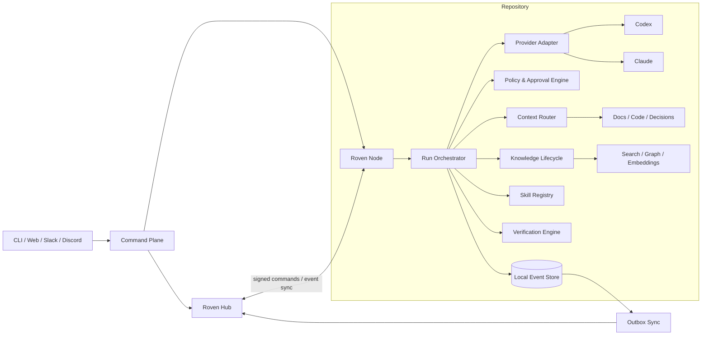
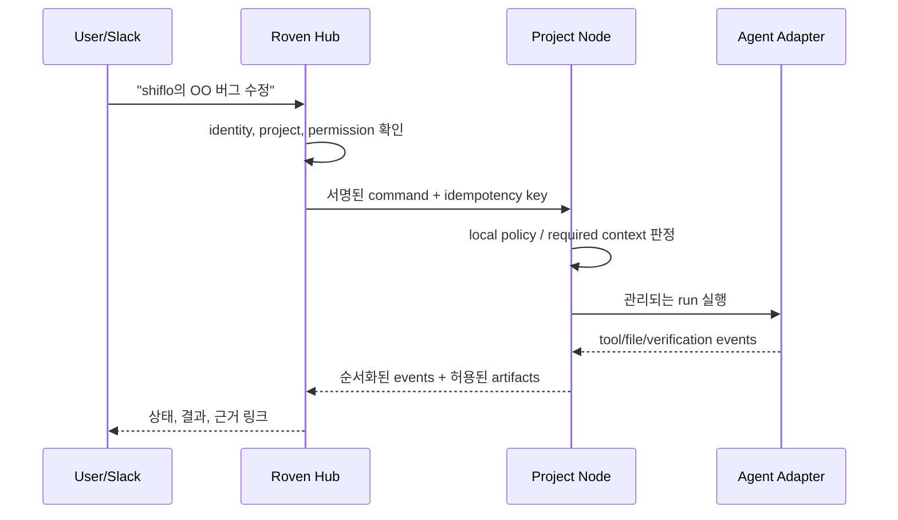

# Roven 시스템 아키텍처

상태: `0.1-draft`  
기준일: 2026-08-18

## 전체 구조



## 배포 단위

### Roven CLI

사람과 자동화의 로컬 진입점입니다. 초기화, 실행, 추적, 진단, 문서 점검, Hub 연결을 제공합니다.

명령 상태:

- `roven init`: 저장소 탐지 및 안전한 초기 설정. project identity 첫 슬라이스 구현 완료
- `roven run <request>`: 관리되는 에이전트 실행
- `roven trace [run]`: 실행 근거와 이벤트 조회
- `roven doctor`: 문서·스킬·어댑터·Hub 상태 진단
- `roven docs check`: 문서 노후화 검사
- `roven hub connect`: 선택적 중앙 등록

### Roven Node

저장소별 로컬 런타임입니다. 초기에는 CLI 프로세스 안에서 동작하고, 원격 작업과 장기 실행이 필요해질 때 선택적 데몬 모드를 제공합니다. Node가 원본 실행 이벤트를 소유합니다.

### Roven Hub

다중 프로젝트의 제어·조회 계층입니다. 프로젝트 등록, 정책 배포, 추적 시각화, 원격 명령, 채널 연동을 담당합니다. 저장소 파일 시스템을 직접 마운트하지 않고 Node가 내보낸 이벤트와 허용된 아티팩트만 저장합니다.

## 저장소 내부 구조

`roven init`의 목표 구조입니다.

```text
.roven/
  project.yaml             # 안정적인 project id와 로컬 설정
  policy.yaml              # 역할, 도구, 승인, 필수 컨텍스트 정책
  documents.yaml           # 관리 문서 수명주기 레지스트리
  skills.lock              # 해석된 스킬 버전과 해시
  generated/               # provider별 생성 원본과 manifest
  state/                   # gitignore 대상: SQLite, CAS, outbox, lock
  knowledge/               # 검증된 프로젝트 지식 또는 기존 지식 경로 연결
```

기존 프로젝트 구조를 강제로 이동하지 않습니다. 문서와 스킬 위치는 manifest에서 연결할 수 있습니다.

M1 첫 슬라이스는 검증 계약이 있는 `project.yaml`, 빈 `documents.yaml`, `.gitignore`와 `generated/`, `state/`, `knowledge/` 디렉터리만 만듭니다. 아직 독립 schema가 없는 `policy.yaml`과 `skills.lock`은 임의 형식으로 만들지 않습니다. 초기화 계획은 `create`, `unchanged`, `conflict`를 구분하며 dry-run에 사용한 같은 계획만 적용합니다. 기존 파일이 유효하면 바이트를 유지하고, 계약 위반이나 심볼릭 링크가 있으면 다른 파일도 만들기 전에 전체 적용을 중단합니다. 새 `.roven`은 임시 트리를 완성한 뒤 한 번의 rename으로 공개하며, 적용 도중 실패하면 임시 트리를 제거합니다.

### Project Storage Bootstrap

`@roven/project`는 설정과 관리 경로만 정의하고 SQLite나 CAS 구현을 알지 않습니다. `@roven/project-storage`가 두 저장 구현을 조합해 실행 진입점에 제공합니다. 저장소 root를 받으면 canonical 경로를 한 번 계산하고, `project.yaml`을 검증한 뒤 그 manifest의 project id로 `.roven/state/events.sqlite`를 엽니다. CAS는 같은 경로 계약의 `.roven/state/cas`를 사용합니다. 호출자가 임의의 project id나 서로 다른 저장 root를 섞을 수 없습니다.

Bootstrap은 저장소 root, `.roven`, `.roven/state`가 실제 디렉터리인지 확인하고 심볼릭 링크를 따라가지 않습니다. 이미 존재하는 CAS 구성 경로도 같은 규칙으로 확인합니다. Event store를 연 뒤 CAS를 열지 못하면 먼저 연 store를 닫습니다. 반환한 handle의 `close`는 여러 번 불러도 각 backend를 한 번만 닫습니다. Hub가 비활성인 manifest는 event 기록을 막지 않으며 outbox 항목을 자동으로 만들지 않습니다.

## 핵심 구성 요소

### Run Orchestrator

요청을 실행 가능한 run으로 바꾸는 상태 머신입니다. 역할 선택, 컨텍스트 준비, 공급자 실행, 승인, 검증, 지식 후보 생성, 완료를 순서화합니다. 공급자 프로세스는 오케스트레이터가 발급한 run/session 식별자를 통해서만 관리 상태가 됩니다.

### Context Router

프롬프트의 유사도만으로 문서를 선택하지 않습니다. 다음 신호를 결합합니다.

1. 저장소 및 하위 디렉터리의 명시적 지침 계층
2. 예상 변경 경로와 문서의 `paths` 규칙
3. 역할별 필수 정책과 산출물 규격
4. 의존성/소유권/명시적 문서 링크
5. 전문 검색 또는 임베딩 유사도(보조 신호)

각 선택에는 `reasonCode`, 일치한 규칙, 정책 버전이 남습니다. 강제 문서는 점수와 무관하게 포함됩니다.

M2 첫 슬라이스의 `@roven/context`는 선택과 읽기를 별도 단계로 실행합니다. 예상 변경 경로마다 root부터 가장 가까운 상위 디렉터리까지 `AGENTS.md`를 찾고, registry의 `connectedPaths` glob, Role의 필수 rule과 handoff를 합쳐 E1 계획을 만듭니다. Registry에 아직 없는 `AGENTS.md`는 정규화한 상대 경로의 SHA-256에서 안정된 document ID를 파생합니다. 같은 경로가 registry의 여러 ID에 연결되거나 필수 rule이 문서로 해석되지 않으면 계획을 만들지 않습니다.

E1 계획에는 원문이나 현재 content hash가 없습니다. Loader는 선택된 파일의 전체 bytes를 읽고 SHA-256과 byte count를 계산한 뒤에만 E2를 만듭니다. 저장소 root와 각 경로 구성 요소의 실제 파일 종류를 확인하고 심볼릭 링크를 따라가지 않습니다. 파일 descriptor를 연 전후의 inode, 크기와 변경 시각을 비교해 읽는 중 바뀐 파일도 E2로 인정하지 않습니다. Plan·문서·E0~E2 체인의 무결성 재검증도 `@roven/context`가 소유하며 문서 배열 순서에는 의존하지 않습니다. 이 계층은 파일을 쓰거나 event를 저장하거나 adapter E3를 만들지 않습니다.

### Context Delivery

`@roven/context-delivery`는 router와 provider adapter 사이의 공급자 중립 경계입니다. `@roven/context`의 E2 무결성 판정을 호출하고 현재 파일·publication snapshot을 다시 확인해 adapter `context_envelope`을 만듭니다. 기본 delivery policy는 64 KiB 이하이며 손실 없이 UTF-8로 왕복되는 원문을 inline으로 선택하지만, 호출자는 문서 metadata를 받는 policy 함수로 선택 규칙을 교체할 수 있습니다. CAS에는 전체 저장소 계약 대신 `put/get`만 가진 좁은 artifact port를 사용하며 put 결과와 다시 읽은 bytes의 hash·크기를 확인합니다.

Writing policy는 ID, document ID와 E2 content hash가 묶인 resolved binding으로 받습니다. 연결된 원문이 UTF-8 JSON `WritingContract` schema를 통과하고 내부 policy ID도 session과 같아야 envelope에 포함합니다. 따라서 다른 E2 문서를 policy 문서로 바꿔 끼울 수 없습니다. Envelope 생성 시각은 E2 적재와 session 시작 이후여야 합니다.

Delivery는 Codex·Claude 구현에 의존하지 않고 `(session, envelope) -> receipt` 함수 포트만 호출합니다. 좌표·시간·문서 집합을 판정하는 순수 함수는 `@roven/adapter-contract`에 한 번만 두고 delivery와 공통 contract suite가 함께 사용합니다. 검증 뒤 문서별 E3 evidence를 만들며, scope는 복사하고 반환 타입을 injected evidence로 좁힙니다. 문서별 evidence ID와 adapter가 반환한 묶음 receipt ID는 `adapterReceiptId`로 연결합니다.

Context generation은 호출자가 소유하는 단조 증가 값입니다. Delivery는 envelope 조립 전, adapter 호출 직전, receipt 수신 뒤에 현재 값을 확인합니다. Compaction이나 restart로 값이 바뀌면 이전 envelope receipt로 E3를 만들지 않습니다. 파일 snapshot은 조립 전, adapter 호출 직전과 receipt 수신 뒤에 확인하므로 호출 중 원문이 바뀌어도 E3를 만들지 않습니다. Adapter에는 managed session/envelope의 격리된 복사본을 전달하고 별도 snapshot과 receipt를 대조해 adapter의 입력 객체 변경이 호출자 상태나 증거에 반영되지 않게 합니다.

### Shared Context Plane

프로젝트 문서와 전문 에이전트가 발행한 결과는 같은 context router에서 찾을 수 있습니다. 에이전트 간 공유 원문은 등록된 문서로 남기고, `SharedContextPublication`이 문서 ID와 content hash, 생산 역할/run/session, 근거 event, 공개 범위, 민감도, 만료 시각과 대체 관계를 연결합니다. `audience.mode=project`인 일반 맥락은 프로젝트의 모든 역할이 읽을 수 있습니다. `audience.mode=roles`는 명시한 역할만 읽을 수 있으며 `restricted` 자료는 이 방식을 반드시 사용합니다.

`HandoffBundle`은 보낸 역할과 받은 역할, 생산 당시 context generation, 요청 digest, 공유 맥락 ID와 근거 event ID만 전달합니다. 원문이나 prompt를 handoff metadata에 복제하지 않습니다. 수신 역할은 `handoff`를 선택 이유로 남기고 연결된 문서를 자기 run/session에서 다시 읽어 E2를 만들며, 공급자에 전달했을 때만 자기 E3를 만듭니다. 생산 역할의 E2/E3는 수신 역할에 상속되지 않습니다.

공유 맥락은 자동으로 검증된 지식이 되지 않습니다. 원문 hash가 바뀌거나 만료되면 기존 handoff를 새 실행에 사용할 수 없고, 대체 publication이나 새 검증이 필요합니다. 발행과 handoff는 역할 간 발견 경로를 만들 뿐, 관련 없는 모든 원문을 매 turn에 넣으라는 뜻이 아닙니다.

### Policy & Approval Engine

파일 쓰기, 셸 실행, 네트워크, 외부 메시지, 배포 같은 capability를 판정합니다. 정책은 역할·프로젝트·환경·위험도에 따라 `allow`, `deny`, `require_approval`을 반환합니다. 필수 문서 주입 증거도 변경 capability의 선행 조건입니다.

### Provider Adapters

Codex와 Claude의 실행 차이를 공통 계약으로 변환합니다.

공통 책임:

- 컨텍스트 envelope 전달과 수신 확인
- 역할과 writing 정책 ID를 세션에 고정하고, 정책 원문이 들어 있는 문서의 E3 주입을 확인
- 공급자 session/run id 연결
- 도구 호출, 파일 변경, 압축/재시작 이벤트 정규화
- capability 요청을 정책 엔진으로 전달
- 중단, 재개, 결과 및 사용량 정규화

정규화 이벤트는 완료되는 배열이 아니라 중단 신호를 받는 스트림입니다. 계약 검사는 필요한 이벤트 수만 제한 시간 안에 확인한 뒤 스트림을 중단하므로, 실제 공급자의 장기 세션 종료를 기다리지 않습니다.

공급자 자체 CLI를 Roven 밖에서 직접 실행하면 강한 보장을 제공할 수 없습니다. Git/파일 시스템 변화로 이를 감지할 수는 있지만 해당 변경은 `unmanaged`로 기록합니다.

### Verification Engine

테스트와 타입 검사뿐 아니라 사람이 읽는 산출물의 writing 계약도 검증합니다. 사람 대상 산출물은 Role이 지정한 언어와 writing 정책에 연결됩니다. 정책에는 독자, 정보 순서, 문장과 문단 원칙, 용어 설명, 행동 표현, 근거 제시 방법이 포함됩니다.

명백한 금지 표현과 빈 섹션은 결정적 검사로 찾습니다. 한국어가 자연스럽고 문단 맥락이 이어지는지는 정규식 통과로 추정하지 않습니다. 생성과 분리된 모델 또는 사람의 의미 검사를 거쳐야 하며, 필수 검사 하나라도 실행되지 않았거나 실패하면 공개하지 않습니다. Codex와 Claude는 같은 정책과 같은 공개 게이트를 사용합니다.

### Evidence Recorder

모든 상태 전이는 append-only 이벤트로 기록합니다. 이벤트에는 단조 증가 `seq`, project/run/session, event type, 발생 시각, actor/provider, 정책 버전, payload, 관련 콘텐츠 해시, 직전 이벤트 해시가 포함됩니다. 해시 체인은 변조 징후를 탐지하기 위한 것이며 블록체인을 도입하지 않습니다.

로컬 저장소는 v0에서 SQLite WAL을 사용하고 큰 본문/아티팩트는 content-addressed storage(CAS)에 둡니다. Hub 동기화는 outbox 패턴으로 재시도하며 `(eventId, destinationId)`가 같은 배송 항목은 하나만 존재합니다. Hub가 설정되지 않은 로컬 실행은 outbox 없이 event만 기록할 수 있습니다.

공통 event 계약이 payload 정리와 결정적 직렬화, hash 계산을 소유하며 SQLite 구현은 저장과 조회만 담당합니다. M1 event store는 하나의 SQLite 파일을 project id에 고정합니다. `seq`와 `previousHash`는 project 전체에서 이어집니다. SQLite는 versioned migration, `WAL`, `synchronous=FULL`, 외래 키와 append-only update/delete trigger를 사용합니다. 같은 event id와 같은 내용은 기존 event를 반환하고, 같은 id의 다른 내용은 거부합니다. Store를 열 때 SQLite `quick_check`, 외래 키, 전체 hash chain과 outbox 좌표를 다시 확인합니다. 동기 transaction callback은 event와 outbox enqueue 또는 ack를 하나의 commit 경계에 묶으며, 비동기 또는 중첩 callback은 거부합니다.

Outbox 항목은 `pending`, `leased`, `acknowledged` 상태를 가집니다. Worker는 제한된 수의 준비된 항목을 안정된 순서로 가져가고 만료 시각이 있는 lease를 받습니다. 다른 worker는 유효한 lease를 가져갈 수 없으며, worker가 사라지면 만료 뒤 같은 항목을 다시 가져옵니다. 전송 실패는 원문 오류 대신 짧은 실패 코드와 다음 시도 시각만 남깁니다. Ack는 현재 lease 소유자만 할 수 있고 중복 ack는 상태를 바꾸지 않습니다. 보존 기간이 지난 ack 항목은 event 원본을 남긴 채 제한된 묶음으로 정리할 수 있습니다.

CAS는 `.roven/state/cas/sha256/<앞 2자리>/<나머지>`에 원문 bytes를 저장하고 `roven-cas://sha256/<digest>`를 반환합니다. 큰 입력은 청크 단위로 임시 파일에 쓰면서 SHA-256을 계산하므로 전체 원문을 한 번에 메모리에 올릴 필요가 없습니다. 임시 파일을 동기화한 뒤 같은 파일 시스템의 hard link로 새 object를 확정합니다. 기존 object와 읽은 object는 모두 주소의 SHA-256과 다시 비교합니다. `has`는 주소가 없을 때만 `false`이며, 변조는 `corrupt_object`로 드러냅니다. 원문은 event payload에 복제하지 않습니다.

### Knowledge Lifecycle

지식은 다음 단계를 가집니다.

```text
observation -> candidate -> reviewed -> verified -> stale -> superseded
```

- 실행 중 사실과 결정은 먼저 observation/candidate입니다.
- 코드 경로와 연결된 지식은 검증 revision과 content hash를 갖습니다.
- 연결 경로가 변경되면 stale 후보가 됩니다.
- 외부 사실은 review interval과 출처를 가집니다.
- 에이전트는 수정 제안을 만들 수 있지만 검증된 지식을 조용히 덮어쓰지 않습니다.

### Search, Graph, RAG

초기 원본 모델은 Markdown/OKF, Git revision, 명시적 링크, 실행 이벤트입니다. 여기서 세 가지 파생 뷰를 만듭니다.

- 전문/메타데이터 검색: 정확한 경로, 키, 태그, 상태 조회
- 관계 그래프: 문서-경로-결정-실행-스킬-산출물의 연결
- 임베딩 인덱스: 표현이 다른 관련 정보 탐색

RAG 결과는 반드시 원본 id와 content hash를 포함하며, 모델에 전달된 실제 원문과 별도로 기록됩니다. v0는 전문 검색과 명시적 관계부터 구현하고 임베딩/외부 그래프 DB는 측정된 검색 실패가 있을 때 추가합니다.

### Skill Registry

스킬은 단순 프롬프트 파일이 아니라 다음 metadata를 가진 versioned package입니다.

- id, source, author/publisher, version, content hash
- 지원 역할과 provider/runtime compatibility
- 필요 capability와 외부 연결
- trust level, 서명/검토 상태, enabled scope
- 설치, 해석, 호출, 결과 이벤트

사용자 로컬 스킬과 외부 스킬은 같은 계약으로 등록하되 출처와 신뢰도를 합치지 않습니다. 실행 시 실제 해석된 버전은 `skills.lock`과 run 이벤트에 남습니다.

M0 skill 계약은 provider 호환성을 `any` 또는 명시적 allowlist로 표현하고, 확인할 수 없는 호환성을 지원으로 간주하지 않습니다. trust는 `untrusted`, 검토자와 검토 시각이 있는 `reviewed`, 유효한 서명까지 확인한 `verified`로 분리합니다. manifest에는 입력값이 아니라 입력/출력 schema reference와 필요한 capability만 저장합니다.

### Document Lifecycle

`AGENTS.md`, `CLAUDE.md`, `README.md`를 포함한 관리 문서는 `documents.yaml`에 등록합니다. 각 항목은 책임자, 검증 revision/date, 연결 경로, review interval, 생성 정책을 가집니다.

자동 생성 시 managed block marker와 생성 입력 hash를 사용합니다. Roven은 블록 밖의 사용자 내용을 보존하며 다음 경우 PR/patch 후보를 만듭니다.

M0 document registry는 document id를 key로 사용하고 소유권을 `user`, `managed_blocks`, `roven_generated`로 분리합니다. `managed_blocks`는 블록 밖을 항상 `preserve`하며, `roven_generated`는 사용자 내용이 없는 Roven 전용 파일에만 사용할 수 있습니다. 실제 marker 문법과 Markdown parser는 M4 전 ADR에서 별도로 확정합니다.

- 연결 경로가 검증 revision 이후 변경됨
- review interval 초과
- 참조한 정책/스킬/명령이 삭제 또는 변경됨
- provider별 생성 문서가 canonical policy와 불일치

## 다직군 에이전트 모델

`RoleProfile`은 다음 계약으로 구성합니다.

- 책임과 허용된 요청 유형
- 필수 입력과 context policy
- 허용 capability와 승인 요구
- 기본 skill set과 호환성
- 산출물 schema 및 저장 위치
- 사람 대상 산출물의 locale과 writing policy
- 검증/evaluation suite
- handoff 규칙

예를 들어 연구자 에이전트는 출처 URL·조회 시점·인용 검증이 필수이고, 마케팅 에이전트는 브랜드 정책과 주장 검증이 필수이며, 디자이너 에이전트는 디자인 토큰과 접근성 검사가 필수입니다. 모두 동일한 run/event/knowledge lifecycle을 사용합니다.

M0 role 계약은 파일 읽기/쓰기, 셸, 네트워크, 외부 메시지, 배포, 데이터 변경 capability를 모두 `allow`, `deny`, `require_approval` 중 하나로 명시하게 합니다. 누락된 capability는 암묵적 허용이 아니라 계약 오류이며, 역할은 최소 E3 context policy, 산출물 schema/저장 위치, 사람 대상 출력의 locale/writing policy, 검증 실패 처분과 evidence를 포함한 handoff 규칙을 함께 선언합니다. Handoff는 원문을 복사한 임의 메시지가 아니라 shared context ID와 evidence link를 가진 bundle이어야 합니다.

## 중앙 명령 흐름



Node가 오프라인이면 명령은 만료 시간과 함께 대기합니다. 조회 요청은 동기화된 데이터의 최신 시점을 명시하고 응답하며, 최신 저장소 접근이 필요한 요청은 Node 연결 없이는 실행하지 않습니다.

## 보안과 개인정보

- 비밀 값, 전체 프롬프트, 사용자 데이터는 기본적으로 이벤트에 저장하지 않습니다.
- 이벤트 payload는 schema별 allowlist와 redaction을 거칩니다.
- Hub로 전송할 event/artifact 종류를 프로젝트 정책에서 제한합니다.
- 외부 메시지, 배포, 데이터 변경은 별도 capability와 승인을 요구합니다.
- 원격 명령은 서명, 짧은 만료 시간, nonce/idempotency key, 프로젝트 scope를 포함합니다.

M0 기본값은 event metadata 90일, 원문 artifact 30일 로컬 보존이며 raw prompt와 문서 본문은 event payload에 저장하지 않습니다. Writing 평가에는 원문 대신 artifact/content hash, 검사 상태, 위반 수와 evidence digest만 남깁니다. Hub 동기화는 기본 비활성이고 payload는 event type별 allowlist와 민감 키 제거를 통과해야 합니다. 자세한 결정과 실패 처분은 [ADR-0001](./docs/adr/0001-m0-contracts-and-data-defaults.md)에 정의합니다.

## 초기 기술 선택

- TypeScript + Node.js 기반 monorepo: 공급자 CLI/JSON 생태계와 빠른 어댑터 개발을 우선합니다.
- SQLite WAL + CAS: 로컬 단일 사용자에서 운영 복잡도를 낮추고 추후 Hub DB와 분리합니다.
- JSON Schema: manifest, event, adapter, role/skill, writing 계약을 검증합니다.
- Markdown/OKF + Git: 사람이 검토 가능한 지식 원본으로 유지합니다.

M0에서는 JSON Schema Draft 2020-12 객체를 TypeScript 상수로 관리하고 같은 객체에서 정적 타입을 추론합니다. 현재 구현은 계약(`schemas`, `event-contract`, `storage-contract`, `adapter-contract`), 정책(`core`), context preparation(`context`), provider-neutral E3 전달(`context-delivery`), project 초기화와 저장 조합(`project`, `project-storage`), 저장 구현(`event-store-sqlite`, `cas`)과 명령 진입점(`apps/cli`)으로 나뉩니다. 실제 Codex/Claude 공급자 어댑터는 M3 범위입니다.

이 선택은 v0의 학습 속도를 위한 것이며 공통 계약과 저장 형식으로 구현 언어 교체 가능성을 보존합니다.
